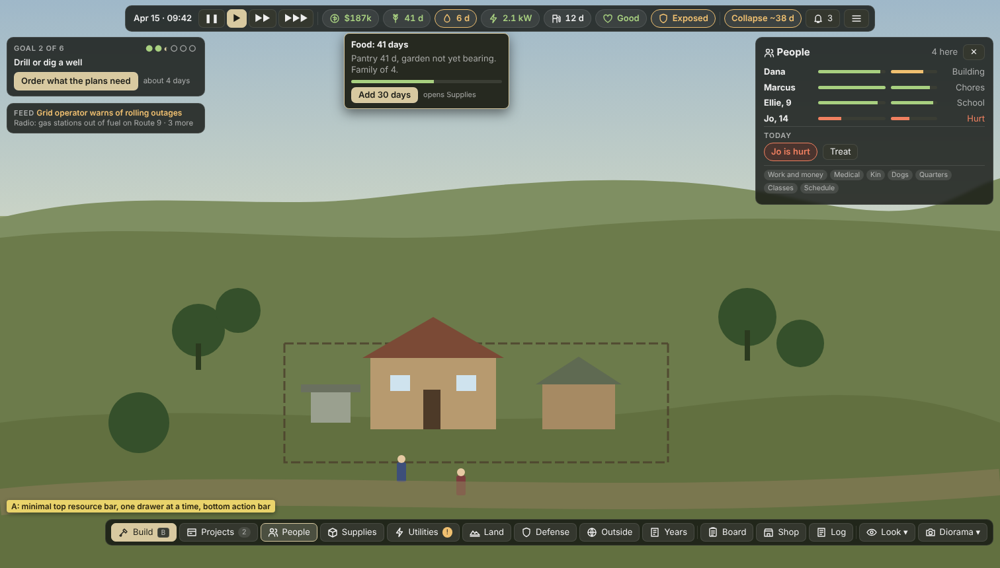
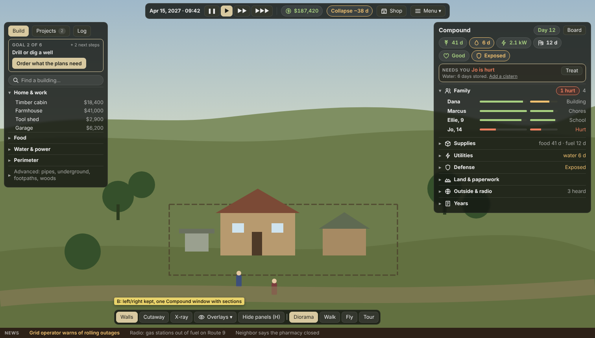
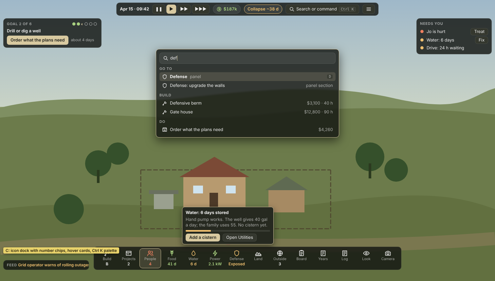
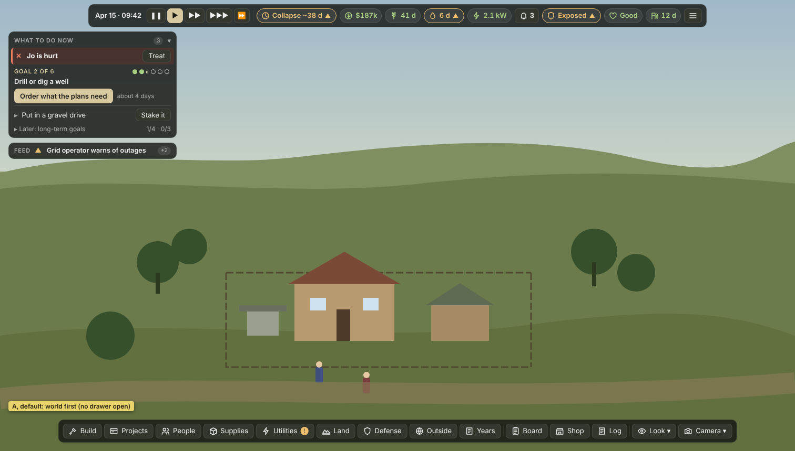
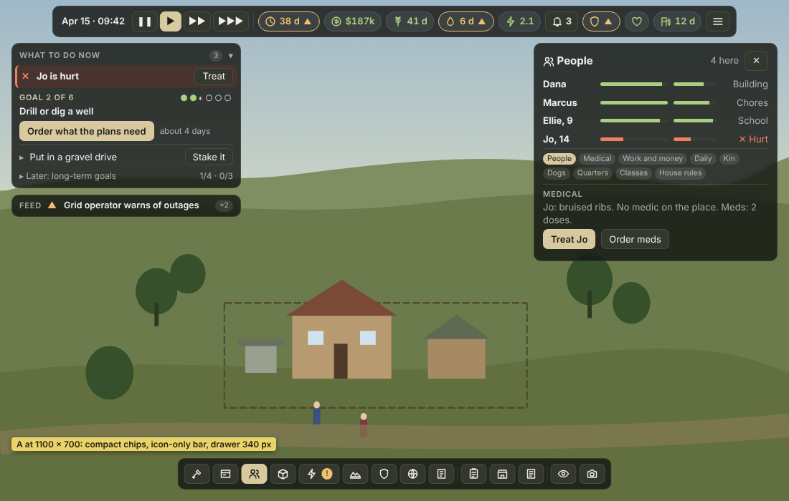
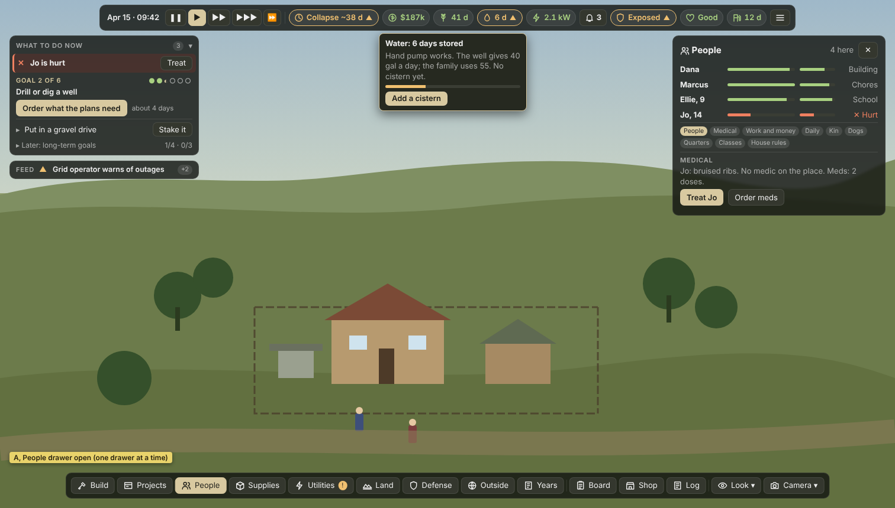
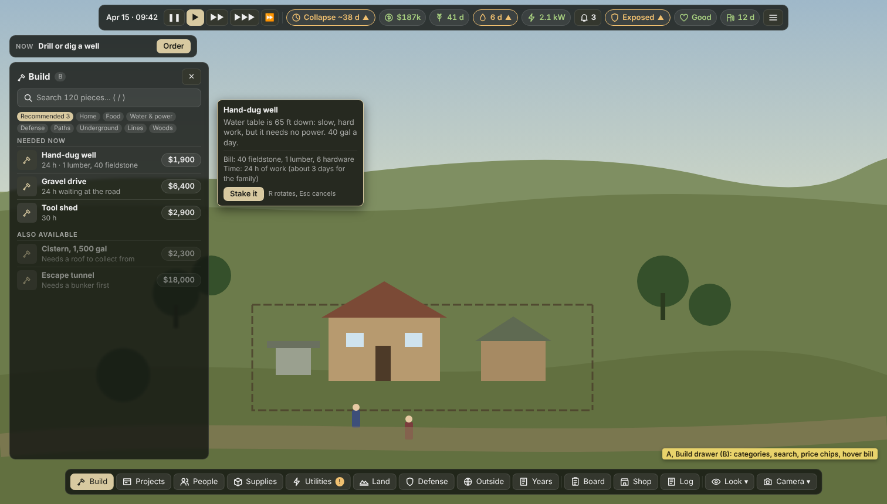

# UX audit: the HUD at 1512 x 860

**Decision (owner): layout A.** Sections 1 to 8 are the audit and the options; **section 11 is the final spec for layout A** (top bar, drawers, What-to-do-now card, popup rules, full mapping checklist, stages S1 to S6, design tokens). Sections 8.3 to 8.6, 9 and 10 are kept as the record of the options considered (section 9's generic stages are superseded by 11.7).

Status: audit and proposals only. No gameplay or UI code changed in this PR (the only files added are this document, the mockup generator and the screenshot script under `docs/ux/`, key frames under `docs/shots/ux/`, and one row in `docs/DECISIONS.md`).
Owner request: the interface feels cluttered and busy compared with games of similar scope; clean it up **without losing any information or function**.
Target display: 14-inch 2021 MacBook Pro, Chrome, default scaled resolution 1512 x 982 CSS px. Primary design size **1512 x 860** (windowed Chrome); full screen is 1512 x 982; floor **1280 x 720** and **1100 x 700**; no horizontal overflow at any of them.
Method: read `Hud.tsx`, `ui/hud/*`, `BuildMenu`, `GoalsCard`, `CompoundBoard`, `DayCard`, `GateCard`, `ShopWindow`, `PeoplePanel`, `WorldPanels`, `Ticker`, the felt cards and the overlay queue on `origin/main` (0512037); ran the real HUD under Playwright (`docs/ux/uxShots.mjs`) at the three sizes; measured screen coverage in the DOM; read the design docs (GDS section 4 and 8, DECISIONS "HUD declutter" rows of 2026-10-24, 10-30, 10-31, 11-06, 11-07); searched for how comparable games lay out their HUDs. Mockups are static HTML rendered at 1512 x 860 (`docs/ux/layout*.png`).

## 0. Verdict in one page

**First impression (first 30 seconds).** A new player sees: a top bar with 13 items (up to 15 with the era and debt chips) (date, time, collapse chip, wave chip, money, Shop & money, New, Save, five speed buttons) that wraps at 1100 px; a left column that is entirely text (a bordered goal card, a second bordered "Next steps" card, then eight folded headings in capital letters); a right column with a wrapped two-row tab strip over name-and-bar rows and a wall of small caps section titles; a bottom-right toolbar of 11 buttons; a news strip along the bottom; and a Welcome card floating under the top bar. The two side panels take 39 percent of the width at 1512 (584 of 1512 px with margins) and 53 percent at 1100, so the world is a window in the middle. The 3D scene is the best thing in the game and the HUD frames it on three sides with the same weight everywhere: nothing is the focal point, because everything is a box of 11 to 12.5 px text.
**First hour.** The "first-hour HUD" hides tabs and folds sections, which helps, but the left column still holds two cards, a nine-section catalog and a long-term list at once, and the same goal is spelled out in four places (section 3).
**Mid-crisis.** The most important moment (the collapse, a raid, a wipe) is handled by good full-screen cards (day card, gate card, felt card). The problem is the minutes around them: the ticker, the Board, the radio list in Outside, the feed and the log each carry a slice of the same story, and 18 different z-index layers plus a dozen hand-positioned toasts compete in the top center and bottom center strips.

**The five root causes** (everything else in this document follows from them):
1. **Every system got its own panel section, and sections are text.** The right panel has 7 tabs and about 60 sections; the Family tab alone stacks 13 sections under the people rows. The "fold it" declutter rounds (DECISIONS 2026-10-30/31) hid detail but kept sentences as the unit of display.
2. **No single home for "what needs me right now".** Goal card, Next steps, Long-term goals, Board "Waiting on you" and "Threats", the ticker, the log, the toast line, the Welcome card and the radio all answer it (section 3).
3. **Permanent chrome for rare actions.** The 244 px catalog, the 11-button bottom-right toolbar, and Save / New / Shop beside the clock are permanent; most are used a few times per session.
4. **No design tokens.** 446 distinct hex colors, about 20 font sizes (251 uses are under 12 px; 11.5 and 11 are the two most common sizes in the codebase), 18 z-index values, hand-offset toasts (section 6).
5. **The HUD does not scale with the window**, it only moves: at 1100 px the panels drop below the wrapped bar and the viewport shrinks to a letterbox.

**What the proposals do** (full detail in section 8): keep every datum and every control, but (a) turn numbers into icon + value chips with hover cards, (b) give "needs me now" one home, (c) make panels contextual drawers that open one at a time, (d) give the world back about 25 to 40 percent more of the screen (measured per mockup in section 8), (e) adopt one type scale, one accent and three semantic colors with a contrast floor.

## 1. Inventory of every on-screen surface

"Clicks" = clicks from the default screen of a new game (left panel on Build, right panel on Family, Welcome card up, nothing open). The first-hour HUD hides right-hand tabs other than Family until the game gives a reason (`sim/tabReveal.ts`); where that matters the count is shown as "n (+1 if hidden)". Source files are under `src/ui/` unless noted.

### 1.1 Always-on chrome

| # | Surface | Where / size | Purpose and data shown | Clicks | Source |
|---|---|---|---|---|---|
| S1 | **Top bar** | top center, wraps, `max-content` | Date, clock, Era chip (era 2+), **Collapse chip** (days to the collapse or its stage), **Wave chip** (siege countdown + 10-step ladder), checking balance (hover: net worth), "owe $" chip (card debt 25+), **Shop & money**, **New**, **Save** menu (Export / Import save), speed buttons (pause, 1x, 2x, 3x, 4x), a "clock holds while you plan" hint under it | 0 | `Hud.tsx` 258-296, `CollapseChip`, `WaveClock`, `SaveMenu` |
| S2 | **Left panel** | left, 244 px, full height minus bottom reserve | Three tabs: Build, Projects (dot when something is held), Log. Footer area: spend-ask confirm, "staked" note, armed-tool hint | 0 | `Hud.tsx` 303-330 |
| S2a | Build tab | left panel | **Goals card** (first-hour goal "2 of 6", strip of the rest, one primary button, "why this matters", honest time, cash advice), **Starter compound** proposal, run-over / foster notes, **Next steps** (up to 3 cards with 1 to 2 buttons), **Long-term goals** (folded; Enclose the compound with Wall my property + Fortify ring, A bunker underneath), Park a joiner's rig, **catalog**: Home & work (18 kinds + Housing styles), Food (18), Water & power, Watch towers & gatehouse (3), Footpaths, Advanced pipes & cables, Underground (bunker order list), Perimeter (price tiers, upgrade chain), Woods (fell tool) | 0 | `hud/BuildMenu.tsx`, `feel/GoalsCard.tsx`, `hud/StarterCompound.tsx` |
| S2b | Projects tab | left panel | Weekend plan, Pace, Under way (work order, "Work on this first"), Stuck and crew jobs, Finished but not working yet, **selected building** (progress, services, hardening, lines going in), Woods | 1 (auto-opens when a building is picked on the map) | `hud/ProjectsTab.tsx` |
| S2c | Log tab | left panel | Last 14 log lines, fading | 1 | `Hud.tsx` 313 |
| S3 | **Right panel** | right, 320 px | Seven tabs (Family, Supplies, Utilities, Land, Defense, Outside, Years) with alert dots and "new" dots; first-hour hiding plus a "Show all tabs" link; wraps to two rows | 0 | `Hud.tsx` 332-336 |
| S3a | Family tab | right panel | People rows (health, morale, task); then **13 sections**: Weekender, Dogs, Kin, Newcomers, House rules, Road, Housing, Quarters, People (mood, who should do what), Medical, Classes, Daily (+ Schedule window), Camp outside the wall (trial), Medicine & household, Work and money | 0 | `Hud.tsx` 336-402, `PeoplePanel`, `SchedulePanel`, ... |
| S3b | Supplies tab | right panel | Stores / Farm sub-tab; Keeping, Hunting & fishing, Wildlife (folded), Food, Stockpile, order list; Farm: calendar, fields, kitchen, food plan, pond, yard | 1 (+1 if hidden) | `Hud.tsx` 403-476, `FarmTab`, `PantryPanel` |
| S3c | Utilities tab | right panel | Heat, Power (yesterday), Water (yesterday), tanker order, hand pump | 1 (+1) | `Hud.tsx` 477-531 |
| S3d | Land tab | right panel | The place (lot, acres, climate), Paperwork (permits, tax, insurance), Land next door (parcels, buy confirm) | 1 (+1) | `Hud.tsx` 532-613 |
| S3e | Defense tab | right panel | Security staff, Reputation on the county road, Defense score and checks, property line, Upgrade the walls, folds (ground and tunnels, wall-top walkway, razor wire, floodlights, towers, houses), Linked yards, Digging, Watching / Fighting / Shelter / Catastrophes checklists, Built for defense | 1 (+1) | `hud/DefenseTab.tsx` |
| S3f | Outside tab | right panel | Taken (rescue), Scavenge, **Rumors** (everything heard on the radio, with confirm status), Outside world, Prisoners, Mines, OPSEC, Neighbors, Market, Trade with neighbors | 1 (+1) | `Hud.tsx` 618-690, `WorldPanels.tsx` |
| S3g | Years tab | right panel | The family, Generations, Eras, Milestones n/16, Chronicle (with photo thumbnails), **Photo album** | 1 (+1) | `Hud.tsx` 864-910 |
| S4 | **Bottom-right toolbar** | bottom right, wraps | Board, View, Walls / Cutaway / X-ray, Underground, Hide panels (H), cameras Diorama / Walk / Fly / Tour (11 buttons) | 0 | `Hud.tsx` 697-710 |
| S5 | **View panel** | bottom left, 560 px, 1 click | Season look, weather, quality, tilt-shift, violence, names, status pips, FPS cap, skip hit cinematic, FPS readout, Try High; **Sightlines** (5 modes + legends), **Terrain** (Off + 6 modes: high ground, lanes, water, fire, shade, sun; legends and readouts), **Blueprint** (+ a 6-line readout), Boundary, **Photo** (time and day sliders, shutter) | 1 | `Hud.tsx` 714-775 |
| S6 | **News ticker** | bottom edge, 26 px | Last six headlines ("NEWS" / "EMERGENCY"), tinted toward red with tension | 0 | `Ticker.tsx` |
| S7 | **Compound Board** | top center, 400 px, non-modal | Feed ("What's different", heard on the radio), 5 vitals (power, water, food, defense, morale) each with a fix button, Wave card, Days with no resupply (runway), Threats, Waiting on you, Defense gaps; Esc closes | 1 | `CompoundBoard.tsx`, `sim/compoundBoard.ts`, `felt/FeedCard.tsx` |

### 1.2 Windows and screens

| # | Surface | Purpose and data | Clicks | Source |
|---|---|---|---|---|
| W1 | **Shop & money** window (full overlay, Esc) | 14 tabs: Building, Fencing, Bunker, Water, Power, Food & farm, Medical & household, Courses & evenings, Fuel & hire, Tools, Guns & ammo, Kit & security, Gold & silver, Money (accounts, debt); "needed now" badges, quick-buy ("Add everything I'm missing", fill to recommended), order sidebar (250 px), spend guard | 1 | `ShopWindow.tsx` (548 lines), `ToolShop`, `shopIcons` |
| W2 | **New game** wizard (3 steps: 1 Region, 2 site / lot, 3 household, relatives, money and difficulty) | 1 (from top bar) | `SetupScreen.tsx` |
| W3 | **Title screen**, **Loading screen** | Continue / New game; boot stages | 0 (on launch) | `feel/TitleScreen.tsx`, `LoadingScreen.tsx` |
| W4 | **Schedule window** | roster (person x hour), templates, falling behind, who is on watch, gatherings | 1 (Schedule... button in the Family tab) | `SchedulePanel.tsx` |
| W5 | **Photo album** | captioned pictures; lightbox | 1 (+1) in Years; the shutter is in View (2) | `PhotoAlbum.tsx` |
| W6 | Save menu | Export / Import save, replace confirm | 1 | `SaveMenu.tsx` |
| W7 | Free build / God Mode panel | start any disaster with a version picker (Outside tab, god mode only) | 1 | `Hud.tsx` 186-212 |
| W8 | **Report card** (ending) | front page of the valley paper, restart options | 0 (event) | `ReportCard.tsx` |

### 1.3 Popups, cards, toasts and overlays (event driven)

| # | Surface | Trigger, position, layer | Behavior | Source |
|---|---|---|---|---|
| P1 | **Welcome card** | new game; top center (62 px), z 15 | until Start or x; moves other toasts down | `hud/Feedback.tsx` |
| P2 | **Toast line** | refused click / hint; top center (62 or 118 px), z 25 | 4.2 s | `Feedback.tsx`, `gameStore.showToast` |
| P3 | **Purchase toast** | after a spend; bottom center (64 px), z 24 | coalesces bursts | `feel/PurchaseToast.tsx`, `feel/feedbackWatcher.ts` |
| P4 | **Milestone card** | 19 milestones; z 26; compact when running | one at a time, 4.5 to 12 s | `PurchaseToast.tsx` |
| P5 | **Cursor hint** | refusal reason beside the pointer; z 20 | while a build tool is armed | `Feedback.tsx` |
| P6 | **Line tool bar** | wall / fence / pipe tool; top center (100 or 168 px), z 16 | live length and cost | `Feedback.tsx` |
| P7 | **Sight / weak-spot / terrain legend chips** | overlay on; bottom center (24 and 64 px), z 20 | one line | `Hud.tsx` 152-176 |
| P8 | **Planning hint** under the top bar | clock running while placing | "clock holds" | `Hud.tsx` 298 |
| P9 | **Camera-mode hint** | walk / fly / tour; top center (54 px) | controls help | `Hud.tsx` 711 |
| P10 | **Home line**, **tour caption** | domestic lines (bottom 96 px); tour title (bottom 60 px) | a few seconds | `HomeLine.tsx`, `Hud.tsx` |
| P11 | **Perf notice** | graphics stepped down; bottom left, z 20 | 8 s | `PerfNotice.tsx` |
| P12 | **Road alert card** | visitor / party at the line; bottom left (64 px), z 20 | needs an answer | `RoadPanel.tsx` |
| P13 | **Gate card** (decision) | someone at the gate, events, aftermath; center, z 12 (cutscene prompt z 40) | stops the clock; about a dozen card styles (arrival, trial end, kin, ransom, insider, guard stay, raid stance, ...) | `GateCard.tsx` |
| P14 | **Hit moment** | disaster hits; full screen, z 15 | CSS cinematic, up to 6 s, any key skips | `felt/HitMoment.tsx` |
| P15 | **Day card** ("The day it happened") | after the hit; full screen, z 14; paper front page | "What changed", "Do first" buttons; clock held | `DayCard.tsx` |
| P16 | **Felt decision card** | disaster choices; center, z 12 | clock held | `felt/FeltCard.tsx` |
| P17 | **Recap card** ("Where we left off") | after Continue; full screen, z 30 | clock held until answered | `feel/RecapCard.tsx` |
| P18 | **Battle banner**, **cutscene prompt and captions**, **live orders** | raid; z 37 to 40 | owns the screen | `BattleOverlay.tsx`, `CutsceneOverlay.tsx` |
| P19 | **Spend confirm** | spend below the living reserve; inline, left panel footer, or inside the Board | two buttons | `hud/SpendConfirm.tsx`, `useSpendGuard.tsx` |
| P20 | **Blueprint, sightline, terrain, weak-spot, property-line overlays** | world-space labels and washes, plus the readouts in the View panel | toggled in View | `game/blueprint/`, `game/sightlines/`, `game/terrain/` |
| P21 | Keyboard | only **V** (building view), **U** (underground), **H** (hide panels), **Esc**, **R** (rotate), WASD / Space / C (walk and fly). There are no keys for speed, tabs, Board or Shop. | | `game/GameCanvas.tsx` 265-274 |

Totals: 3 permanent panels + 1 bar + 1 ticker, 7 right tabs and 3 left tabs, about 60 right-panel sections, 14 Shop tabs, 8 windows and 16 transient card types.

## 2. Screenshots and annotated problems

Captured from the **real game** (live HUD, software GL, Low quality, `docs/ux/uxShots.mjs`) at 1512 x 860, 1280 x 720 and 1100 x 700. Full-size frames are in the gitignored `shots/ux/`; downscaled key frames are committed under `docs/shots/ux/`. Raw metrics: `docs/ux/metrics-real.json` (HUD coverage of the viewport, controls on screen, horizontal overflow).

**Measured, today's HUD**

| Frame | Panels cover | Center half covered | Controls on screen | Horizontal overflow |
|---|---|---|---|---|
| Day 0, 1512 x 860 | **41.8 %** | 12.2 % | 55 | none |
| Day 0, 1280 x 720 | 47.2 % | 19.5 % | 48 | none |
| Day 0, 1100 x 700 | **55.2 %** | 28.9 % | 48 | none |
| Day 3 mid-build, 1512 x 860 | 39.3 % | 7.1 % | 52 | none |
| Day 3, 1280 x 720 | 43.6 % | 12.3 % | 46 | none |
| Day 3, 1100 x 700 | 50.6 % | 19.7 % | 45 | none |
| All seven tabs shown, 1512 / 1280 / 1100 | 41.8 / 47.3 / 55.2 % | 12.2 / 19.5 / 28.9 % | 59 / 54 / 52 | none |

The Classic HUD never overflows horizontally at any of the three sizes (the existing `hudLayout` works), so the problem is not breakage; it is **density**: more than half of a 1100 x 700 window is HUD, and about 40 percent of a 1512 x 860 window is HUD while the world gets the middle strip. Layout A's target is 15 percent at rest.

### 2.1 First 30 seconds: day 0, 1512 x 860


| # | Problem (as a player sees it) | Fix (section) |
|---|---|---|
| 1 | The top bar shows only date, time, cash and six buttons. **There is no food, water, power or threat anywhere on screen**; the first sign of trouble will arrive as a sentence in a panel | Vital chips and the threat chip (11.1) |
| 2 | The **Welcome card** under the bar repeats the Get operational card in words ("follow the Get operational goals on the left") and covers the top of the world; it is also outside the overlay queue | First-run hint on the goal row (11.5) |
| 3 | The left column is **the catalog**: nine rows of three lines each ("1400 h · crew adds ~$84,000 · permit $2,500") before the player has asked to build anything. The one thing to do (the goal card, "Lay out a starter compound") is a small card at the top | Build drawer (B), price chip per row, the rest on hover (11.3) |
| 4 | The right column stacks **four people with three bars each plus a "how they are" button**, then Dogs, Relatives, Housing, Quarters and How everyone is, all open at day 0. It scrolls | People drawer with sub-page chips (11.2); people become one row each |
| 5 | The panel tab strip shows two tabs and a "Show all tabs" link at 11 px | Action bar with all buttons dimmed, not hidden (11.2) |
| 6 | **Nothing is the focal point**: every box is the same dark rectangle with 11 to 12.5 px text; the most alarming line ("Underactive thyroid, Asthma: 30 days of thyroid pills") is amber 12.5 px text in the middle of a stack | One loud element: the What-to-do-now alarm row (11.4) |
| 7 | The world, top-down over snow, is the strongest thing on screen and the HUD adds no hierarchy to help read it | Tokens and a calmer top bar (11.8) |
| 8 | Dim gray 11 px text over bright snow ("crew adds ~$54,000", "Beds 6 · couches 2 ...") is the measured 4.09:1 failure | Contrast tokens (8.2, 11.8) |


At **1100 x 700** (floor): the Welcome card **covers the right panel's tab strip and the first person's name** (a real collision: z 15 over a panel, not in the queue); the panels are 55 percent of the window; the catalog shows five rows and no goal beyond the first.

### 2.2 First hour: day 3, mid-build


| # | Problem | Fix |
|---|---|---|
| 1 | **Three cards for one idea** stacked in the left column: Get operational (title, 6-dot strip, button, "Why this matters", reward, "Hide goals", a green "Staked 8 pieces" note), then "ALSO OPEN: START ANY OF THESE NOW" with three more buttons, then NEXT STEPS, then LONG-TERM GOALS, then the catalog | One What-to-do-now card (11.4) |
| 2 | **The same order is offered four times** in different words: "Order what the plans need (~$117,195)" in the goal, again under Water, again under Power, and "Order 51 pallets of fieldstone ($15,375)" under Next steps | One list, deduplicated by action (`sim/whatToDo.ts`, 11.4) |
| 3 | A 5-line paragraph about the county permit ("at the family's pace: about 9 months ... A crew of four: about 5 weeks, ~$54,000") sits inside the card; it is useful, but it is prose where a chip ("permit 18 d · crew 5 wk") with a hover would do | Chip + hover card (section 4) |
| 4 | The red line that matters most, "3 people have no bed, 3 out in the weather. Buy 1 tent $180", is the **fourth section** down the right panel under Dogs, Relatives and the Housing heading | Alarm row on top of What to do now (11.4) |
| 5 | Tab alert dots are **color only** (red, orange, blue) and 6 px | Tone badge with glyph on the action-bar button (11.2) |
| 6 | The tab strip shows Family, Supplies, Utilities, Land and Defense and is cut at the panel edge; the player cannot tell more tabs exist | Dimmed buttons (11.2) |


At **1100 x 700** the goal card alone fills the left column: **Next steps is below the fold** (only its heading peeks above the panel edge), so the second thing the game wants the player to do cannot be seen without scrolling. The right panel loses the tab strip's last tabs the same way.

### 2.3 All tabs on, 1512 x 860


With "Show all tabs" the seven tabs (Family, Supplies, Utilities, Land, Defense, Outside, Years) fit one row **only by shrinking to about 11 px with no padding**; each is well under the 28 px target floor; "Show all tabs" becomes "Hide unused tabs". The Family body is the same six stacked sections; the Housing section's fix text and button repeat what the red line above says. The left catalog's suggested row ("suggested: no roof over the family yet: a modular home ...") highlights a recommendation inside a list of nine, a third copy of the goal.

### 2.4 Mid-crisis: a disaster, hit moment to week 1

The scenario is the long blackout (grid down, a coordinated substation attack) started through the Free build route, then played with the real sim: the day card at the hit, a felt decision card on day 2, week 1 with the Board open. **Capture caveat:** the harness never pressed Start, so the Welcome card is still on screen in several frames; it is a script artifact, but it shows the layering problem (the Welcome card, z 15, draws over the day card, the Board and the Shop). In a real game it goes away when the clock first runs.


The day card (the Valley Ledger front page) is the best-designed surface in the game: one headline, **What changed**, **What still works**, **Do first** with buttons, **Face it**; it fits 1512 x 860 and scrolls inside at 1100 x 700 (the 2026-11-17 fix). Problems: the **Welcome card draws over its masthead**; behind the 62 percent dim the top bar's collapse chip ("Impact: within a day") is the only warning the player had and it is a small outlined pill; the left goal card now reads "THE LONG BLACKOUT: THE FIRST WEEK, 3 of 5" with its sub-title **repeated twice side by side** ("Have a way to water without grid power (hand pump, solar pump, gravity)").


| # | Problem in the crisis frame (day 8, nothing to eat) | Fix |
|---|---|---|
| 1 | **A cheerful milestone card ("Three generations under one roof +40 family points") sits in the middle of the map** while the family is out of food; the alarm is a small red "Out of food for 4 days" card at the lower left | Alarms are loud, milestones are corner toasts that wait (11.5) |
| 2 | **Hunger is stated six or more times at once**: Next steps ("Out of food for 4 days"), the Family tab ("hungry" on three people), Newcomers ("People to feed 5 · 0 days of food"), the ticker, and with the Board open also its Food vital, the runway row and "Stock some food" | One alarm row and one food chip (11.1, 11.4; section 3) |
| 3 | The ticker is a red full-width bar with a scrolling run of long sentences ("A station out of the city, faint: the weather: valley fog by dawn, the camp will be in it (sight 3,773 ft at first light); it should lift at ...") that cannot be read at a glance | Breaking news only, one short line (11.4) |
| 4 | Both side panels are at full strength: 49 percent of the screen is HUD and the center strip (the compound) is where the milestone sits | Drawer closed at rest (15 percent) |
| 5 | The collapse chip became a bordered "Day 8" pill; the top bar still says nothing about food, water or power, the three things that decide the week | Vital chips with ▲ / ✕ glyphs (11.1) |


The **Board** is a good page (tone dots, one row per vital with a fix button, runway, "Waiting on you") and the closest thing today to layout A's What-to-do-now content. Problems: at 1100 x 700 it is a 400 px column in the middle of a 1100 px window between two 244 and 320 px panels, so **the map is gone** (86 percent of the window is HUD, measured); the Welcome card covers its title and first rows; it does not pause the clock; and its content is the **fifth copy** of facts shown in the left card, the right tab, the ticker and the top bar. Felt decision cards and the Shop (below) have the same "HUD still at full strength around a card" property:


The felt card (day 2, "Protect what still works") is well made: three options with a price chip, hours and odds in plain words, "The clock waits for you", and it fits the window. It is only crowded by two full panels, a red ticker and the top bar around it, with almost no dim, so the player's eye has no single place to land.

Measured in the crisis frames (1512 / 1280 / 1100): week 1 panels cover **49 / 57 / 60 percent**, with the Board open **67 / 75 / 87 percent** (center half 59 / 70 / 86 percent), with a felt card up **61 / 74 / 84 percent**.

### 2.5 Other surfaces (1512 x 860 unless noted)

| Surface | Frame | Observations |
|---|---|---|
| **View panel** |  | Nine controls with **no visible labels**: three selects reading "auto", "auto", "low" (season, weather, quality; the labels are tooltips only), "Graphic", "Names on", "Status pips on", "uncapped"; overlays (Sightlines, Terrain, Blueprint, Boundary, Photo) share the panel with graphics settings. It is a 560 px wide block above the toolbar that covers 40 percent of the center strip at 1100. Fix: Settings modal with labeled rows + one Overlays menu (11.2) |
| **Shop & money** |  | The strongest visual language in the HUD: icon cards, price at the right, a "have 0" count, steppers, kits on the right, one primary button. Gaps: 14 tabs wrap to two rows (the second row begins with "Kit & security"); the Welcome card draws over the header here too. **This is the look the rest of the HUD should match** (icon + number + one action) |
| **Left Log, Projects** | `shots/ux/tabs-left-log-1512x860.png`, `tabs-left-projects-1512x860.png` | Plain lists; Log is the last 14 lines fading, so a week of history is unreachable here (it lives in Years) |
| **Right tabs** (Supplies, Utilities, Land, Defense, Outside, Years) | `shots/ux/tabs-tab-*-1512x860.png` | Same "stack of small-caps sections" pattern; Land covers 41.8 percent, Outside 26.1 percent (a short tab leaves the panel small, so the HUD footprint changes from tab to tab) |

**Overflow check.** Every capture at 1512 x 860, 1280 x 720 and 1100 x 700 has `hScroll: false` and no fixed element outside the window (`docs/ux/metrics-real.json`): the Classic HUD never overflows horizontally. Layout A keeps that guarantee by construction (11.1).


## 3. Duplicates and overlaps (one source of truth for each)

The same fact shown in several places is the main reason the screen feels busy: the eye cannot tell which copy is current, and each copy takes space. Rule proposed: **each fact has one owner surface; every other mention is a link or a chip that opens the owner.**

| Information | Where it appears today | Single source of truth (proposed) | What the others become |
|---|---|---|---|
| **What to do next** | Goals card (Build tab), Next steps cards (Build tab), Long-term goals (Build tab), Board "Waiting on you" + "Threats" + "Defense gaps", day card "Do first", Welcome card text, recap card "three next steps", Projects "Stuck" cards | **One "Needs you" list** (ordered by urgency, built from `suggestions()` + `operational` + `compoundBoard`) and, when one exists, the **current goal chip** on the map | Board lines, day card and recap read the same list; Welcome card becomes a one-time tooltip on the goal chip |
| **Vital signs** (food days, water days, power, fuel, defense, morale) | Board vitals (5 rows), Board runway ("Days with no resupply"), Supplies tab (Food), Utilities tab (Power, Water), Defense tab (score), Family tab (mood), Blueprint readout ("Defense 62"), tab alert dots, goal card ticks (water, food, power) | **Top-bar vital chips** (icon + number + tone), hover card with the breakdown | Board vitals row disappears (it is the chip strip); tab dots stay as the same tone; tab bodies keep the detail |
| **Money** | Top bar (checking, hover net worth, owe chip), Shop sidebar (cash, funds), Money tab, spend-ask text, purchase toast ("cash left"), Family "Work and money", Land (parcel price vs cash) | **Top-bar cash chip** (hover: net worth, debt, runway in months) | Purchase toast shows only the delta; Work and money stays as the income breakdown |
| **Time to disaster / threats** | Collapse chip, Wave chip (top bar), Board Wave card, Board threats, ticker "NEWS", Outside tab rumors, day card, Defense checks, recap card "next wave" | **One threat chip** in the top bar (collapse clock until the hit, wave clock after) | Board Wave card is the chip's hover card and click target |
| **Radio and rumors** | Ticker (every line, via `disaster.news`), Board "heard" list (last 3 + check status), Outside tab Rumors (all), Board feed top line goes to the ticker too (`feed.ts`) | **Outside tab > Radio** keeps the full list with check status | Ticker shows only the top line or an alert; Board shows one line "3 heard, 1 unchecked" |
| **"What changed today"** | Board FeedCard (up to 6 lines), ticker top line, log (last 14), day card "What changed", recap card | **Feed** (one list, one surface, day-stamped) with the log folded in as its older entries | Log tab merges into the feed history; ticker keeps only the single highest-tone line |
| **Event log** | Log tab (last 14), ticker (last 6 headlines), Years chronicle, toast line, purchase toast, milestone card | **Log** for sim lines, **Years** for the long record | Toasts are not copies: they are the live form of one log line and fade |
| **Who is hurt / who needs care** | Family tab (red bar, "Hurt"), Medical section, People section ("not coping"), Board morale vital, Next steps ("help ..."), tab dot on Family | **People drawer** (one row per person with a status glyph) | Board morale line, dot and Next steps cite it |
| **Build state of a building** | Projects tab (selected), Under way list, Build tab (Next steps "Stake it"), spotlight in-world label, Board "stuck project" | **Projects** (list) and in-world marker (selection) | Build tab shows only the catalog and the goal |
| **Defense score** | Defense tab, Blueprint readout, Board vital + gaps, tab dot, Long-term goal "Enclose the compound" ticks, fortify ring | **Defense tab** (the score and checks) | Chip + Blueprint overlay readout link to it |
| **Saves and settings** | Save menu in the top bar (Export / Import), View panel (graphics, FPS, violence, names, skip hit cinematic), New (top bar), title screen | One **Menu** (hamburger): New, Save / Load, Settings, Help | Top bar loses three buttons |
| **Camera / view controls** | Bottom-right toolbar (3 views, Underground, Hide panels, 4 cameras), View panel (overlays), keys V U H | One **View menu / dock group** plus keys | Same controls, one home |
| **Tool hint** | Left panel footer note, `LineToolBar` top center, cursor hint, planning hint, `hudHidden` tool hint (top-left) | One **tool banner** (top center) + cursor hint only for a refusal | Footer note removed |

Overlap measured in the code: the same 5 fact families (vitals, money, threats, radio, next steps) are drawn in 4 to 8 places each.

## 4. Text-heavy rows that should be an icon + number chip (with a hover card)

Rule: if a row is `label: value` with a tone, it is a chip. The sentence moves to the hover card (and stays in the tab body where a decision is made). Nothing is deleted; the long text is one hover or one click away.

| Today (text row) | Chip | Hover card keeps |
|---|---|---|
| Top bar "Collapse in ~38 d" + wave ladder | clock icon + `38 d`, red under 7 d | stage, what the warning signs mean, ladder |
| Checking `$187,420`, "owe $4,300" | coin + `$187k`; debt as a second small red chip only when owed | exact balance, net worth, owed with lien, runway |
| Board vital rows "Food: 41 days of stores" | wheat + `41 d` | days by source, daily need, what the fix does (Add 30 days) |
| Utilities "Power (yesterday): made 3.1 kWh, used 2.9" | bolt + `2.1 kW` or `+0.2` | the full power table |
| Utilities water "Water (yesterday)" | drop + `6 d` | liters in and out, hauling |
| Family rows (name, health bar, morale bar, task) | avatar dot + two micro bars; the 4-word status becomes one glyph (hammer, broom, book, bed, cross) | task text, skills, conditions |
| Defense "Defense 62 Guarded ... Line holds 71 % ..." | shield + `Guarded` | score, ring count, gates, towers, lanes, sight lines |
| Supplies stockpile lines (one text line per good) | grid of small tiles: icon + count (like an inventory) | name, price, days of use |
| Next steps cards (title, 2-line why, 1 to 2 buttons) | row: icon + title + one button; "why" on hover | the two-line reason, cost, time |
| Goal card "Why this matters" + "honest time" | tooltip on the goal chip | full text |
| Land parcels ("40 acres, $212,000, 3 miles, owner ...") | row: acreage chip + price chip + Buy | the full line |
| Years "Milestones 9/16" list | 16 small badges (dim until earned) | name, date, story |
| Radio lines in Rumors | icon by source (radio, neighbor, trader) + 1-line claim + status glyph (confirmed, false, open) | full line, who said it |
| Ticker headlines | single line, newest first, tone dot | log list |
| Shop cards (name, price, "needed now", owned, +/-) | already icon cards; keep; remove the second text line when owned = 0 | text |
| Build catalog items ("Timber cabin $18,400, 120 h, notes") | tile with a drawn thumbnail of the kit piece, price chip | hours, bill of materials, notes |

## 5. Always visible, but should be contextual or collapsed

| Item | Why it should not be permanent | Proposed rule |
|---|---|---|
| **Building catalog** (dozens of kinds in 4 open groups plus 5 folded ones) always in the 244 px left column | Used in bursts (a few minutes per play hour); holds a 244 px column of the screen the rest of the time | A **Build drawer / dock** that opens on **B** or when a tool is armed; closes when placing finishes; the goal chip stays |
| **Goals card + Next steps + Long-term goals** (three cards, one concept) | Same concept in three styles | One **goal chip** (always) and one **"Needs you"** list in the drawer |
| **Seven right tabs**, wrapping to 2 rows at 320 px, with 60 sections | Hick's law: 7 tabs x 8 sections = 56 places; users do not know where "radio" or "kids' school" lives | Group by intent: **People**, **Supplies & farm**, **Power & water**, **Defense**, **Land & town**, **Years**; merge Outside into Land & town; rarely used sections fold behind "More" |
| **Family tab's 13 sections**, most hidden by default only through conditions | Most players never have Weekender, Kin, Newcomers, House rules, Classes, Dogs at once; yet they take vertical space whenever they apply | People rows on top; the rest become one row of **section chips** that open as a sub-page |
| **Bottom-right toolbar** (11 buttons) | Building views and cameras are needed rarely, and V, U, H already exist as keys | Collapse to 3 icons (Views, Cameras, Hide) with menus; keep keys |
| **View panel** (about 30 controls in 3 groups) | Graphics settings are set-and-forget; overlays are inspection modes | Split: **Settings** (graphics, FPS, violence, names, skip cinematic) into a modal; **Overlays** (sightlines, terrain, blueprint, boundary, photo) into one dropdown |
| **News ticker** (26 px, permanent once any news exists) | A strip across the whole bottom edge for text that mostly repeats the feed; it also pushes the toolbars up | Show one line only when new, tone dot; the rest is in the Feed |
| **Top bar buttons** Shop & money, New, Save | New and Save are rare | Menu (hamburger); Shop gets an icon button with a hotkey |
| **Wave chip** when no wave is possible yet | Empty items teach the player to ignore the bar | Show only when a clock exists; merge with the collapse chip |
| **Welcome card** | One-time | Fold into first-run tooltips on the goal chip and the clock |
| **Tab strip "Show all tabs" link** | Escape hatch for the hiding rule | Becomes unnecessary when tabs are icon dock buttons that are dimmed (not hidden) |

## 6. Popup stacking and overlay priority

What exists: `sim/overlayQueue.ts` (pure, tested) orders the **blocking cards**: title > ending > raid cutscene > decision (gate) > hit moment > day card > felt card > recap > milestone, and holds lower cards while a placing tool or the Board is open. That part works and should be kept. The problems are everything the queue does **not** know about (found by reading the code; the screenshots in section 2 confirm the ones marked "seen"):

| # | Problem | Evidence | Effect | Fix (all three proposals) |
|---|---|---|---|---|
| 6.1 | **Eighteen z-index values** (1, 2, 3, 5, 11, 12, 14, 15, 16, 20, 24, 25, 26, 30, 37 to 40, 50, 60) scattered over 22 files; no tokens | `grep zIndex src/ui` | Order is accidental: Shop 11 < Gate 12 = Felt 12 = Report 12 = Setup 12 < Day card 14 < Welcome 15 = Hit moment 15 < Line bar 16 < Road card 20 = Perf notice 20 = Cursor hint 20 < Purchase toast 24 < Toast 25 < Milestone 26 < Recap 30 < Title 40 = Gate prompt 40 | Seven named layers (`hud`, `drawer`, `banner`, `toast`, `modal`, `cinematic`, `blocking`) as CSS variables; no literal z-index in components |
| 6.2 | **Road alert card (z 20) and Perf notice (z 20) sit above decision cards (z 12 to 14)** and are not in the queue | `RoadPanel.tsx` 16, `App.tsx` mounts `RoadAlert` whenever not in a raid | A "visitor at the line" card can draw over a gate card or day card, and it asks for an answer while the clock is held | Road alert becomes a queue entry (or a banner in the top-center slot, never over a modal) |
| 6.3 | **The Road alert card is positioned over the left panel** (left 12, bottom 64, 330 px wide, z 20) while the panel runs down to the bottom reserve (about 82 px) | `RoadPanel.tsx` 16 vs `hudLayout.ts` `bottomReserve` | The card covers the last ~80 px of the Build list, including buttons | Slots (below) |
| 6.4 | **Top-center strip has six residents with hand-tuned offsets**: top bar (10 to ~50), planning hint (under the bar), camera-mode hint (top 54), Welcome (top 62), Toast (62, or 118 if Welcome is up), Line tool bar (100, or 168 if Welcome is up), Board (top of the panels) | `Feedback.tsx` 31, 41, 48; `Hud.tsx` 298, 711 | They overlap whenever two are on at once (a refused click while placing a fence with the Welcome card up: three stacked at 62, 118 and 168); the offsets are encoded as `welcome ? 118 : 62` | One **banner slot**: top center under the bar, a vertical stack with a max of 2; the newest replaces the oldest of the same kind |
| 6.5 | **Bottom-center strip has six residents at nearly the same height**: Sight hint (64), Weak-spot hint (64), Purchase toast (64), Tour caption (60), Home line (96), Terrain legend chip (bottom 24, which sits on the 26 px ticker) | `Hud.tsx` 155, 174, 162; `PurchaseToast.tsx` 13 | A purchase toast lands on the viewshed hint; the terrain legend overlaps the ticker | One **toast slot** (bottom center above the dock) with a queue; overlay legends move into the overlay menu's own chip |
| 6.6 | **Esc is handled by four unrelated window listeners** (camera leave, Board close, Shop close, New game close) with no stack | `GameCanvas.tsx` 265, `CompoundBoard.tsx` 20, `ShopWindow.tsx` 208, `SetupScreen.tsx` 99 | One Esc can leave walk mode, close the Board and close the Shop together | One `useEscape` stack: topmost layer handles it, others do not |
| 6.7 | **Welcome card is not in the queue** (z 15) and the first-run HUD also hides tabs | `Feedback.tsx` 45 | At 1100 x 700 it overlaps the top bar's wrapped second line | Fold into first-run tooltips on the goal chip; if kept, banner slot |
| 6.8 | **Blocking cards dim the whole scene** (day card 62 percent black, recap 45, report 70, felt/gate card backdrop) | `DayCard.tsx` 38 and others | Fine for a front-page moment, heavy for a choice that must be answered with the world in view (e.g. which wall to fall back to) | Keep dim for the day card and report; use a **side sheet** (right drawer, no dim) for felt and gate decisions that need the map; the hit moment stays full-screen |
| 6.9 | **Board is not modal but does not pause**, and it sits over the map center (400 x up to 700 px) | `CompoundBoard.tsx` 56 | The reader watches a clock run while reading; it hides the area where things happen | Becomes a drawer (A, B) or the "Today" page of the dock (C); same pause rule as the cards (pause while open, optional) |
| 6.10 | **Priority between a toast and a card is unwritten**: the purchase toast (24) and milestone (26) draw above a gate card (12) | z values | A milestone card can pop over a pending decision; the queue prevents it for the card form but not the toast form | Toasts never draw above `modal`; a toast that arrives while a modal is up is queued |

Proposed model (shared by A, B and C): **four non-modal slots + one modal layer**.
1. `top-banner` (under the top bar, center): tool instructions, planning hint, camera hint, Welcome. Max 2.
2. `toast` (bottom center above the dock): purchase, refusals, milestone-compact. Queue, 4 s each, never above a modal.
3. `drawer-left`, `drawer-right`: Build, Needs you, People, Supplies, Defense, Board. Max one open per side; Esc closes the topmost.
4. `modal` (queue as today): gate, day card, felt card, recap, report, Shop, New game. One at a time, the existing `overlayQueue` (keep and extend with `road`, `welcome`, `perf`).
5. `cinematic` and `blocking` (hit moment, cutscene, title, loading) above all, as today.

## 7. How comparable games organize a similar HUD

Honest note on evidence: for most of these I could find wiki, press and forum descriptions rather than formal UX studies; where a source is a community page I say so. Screenshots were not embedded (no external assets); the linked pages show them.

| Game | What its HUD does | Pattern worth copying here | Source |
|---|---|---|---|
| **RimWorld** | Colonist bar across the top (portraits with status icons), a single row of text tabs along the bottom (Architect, Work, Schedule, ...), the inspect pane bottom left for the selection, speed and date bottom right, alerts as small icons at the right edge | The **inspect pane follows the selection** (we already do this in Projects); **one bottom tab row** instead of two side panels; **people as a bar of portraits with status icons**. Caution: its Architect menu is a well-known pain (grows to several rows, "information hidden under multiple layers"), which is exactly our catalog and right-tab problem | [RimWorld wiki: User interface](https://rimworldwiki.com/wiki/User_interface); [PC Gamer beginner's guide](https://www.pcgamer.com/uk/rimworld-guide); Steam discussion on UI depth (linked from the wiki search) |
| **Frostpunk** | All resources, needs and currencies on one strip at the top; the temperature as the big central dial; a resource icon turns golden when output meets demand, a positive or negative number shows the gap, and the bar turns red when stores are empty | **Icon + signed number + tone** per resource, one strip, nothing else competing; a **single central dial for the one number that matters** (our collapse / wave clock); circular menus on a gamepad (radial) for command layer | [PCGamesN: Frostpunk 2 UI](https://www.pcgamesn.com/frostpunk-2/ui-improvements); [Gamepressure: Frostpunk 2 economy](https://www.gamepressure.com/frostpunk-2/economy/z5115e9); [Xbox Wire: radial-driven design](https://news.xbox.com/en-us/2019/09/20/frostpunk-console-edition-radial-driven-design-of-gameplay-and-controls/) |
| **Banished** | One status bar (town name, season and year, population split, weather, inventory totals, average health and happiness); a left stack for town info and townhall; professions bottom left; minimap top right (community description) | **One compact status line with totals** and the detail on hover; the rest is plain and small so the world dominates | [Banished wiki: status bar](https://banished.fandom.com/wiki/File:Status.png); [World of Banished forum](https://worldofbanished.com/index.php?topic=67.0) |
| **Project Zomboid** | A slim left bar of icons (hands, inventory, health, crafting), status "moodles" as icons at the right edge that show severity by color and shape, health panel opened on demand, a 1 to 5 hotbar | **Status as small icons whose shape carries the meaning**, not color alone; panels opened on demand from a slim icon rail | [PZwiki: HUD](https://pzwiki.net/wiki/HUD) |
| **Cities: Skylines (1 and 2)** | A bottom toolbar of tool categories; info views (19 in CS1, 33 in CS2) behind one icon (top left in CS2) and grouped into categories; CS2 opens the related info view automatically when a construction menu opens; budget as a panel with hover detail | **All overlays behind one menu**, grouped; **pair an overlay with the tool it informs** (opening Defense shows sightlines); a budget slider whose detail shows on hover | [Dev diary 9: Info Views](https://admin-forum.paradoxplaza.com/forum/developer-diary/cities-skylines-dev-diary-9-info-views.833752/post-18849702); [Gameplay.tips: CS2 info views](https://gameplay.tips/guides/cities-skylines-ii-info-views-guide.html) |
| **Two Point Hospital** | A compact main panel bottom left, finance bottom right with income, expense and profit on hover, visual overlays for breakdowns, sub-menus for depth; the team says they chose not to put lots of tables and buttons on screen and let players discover depth | **Money chip with hover breakdown**; **depth by discovery, not by display**; a small number of large friendly buttons | [Magic Game World: UI and reading your menus](https://www.magicgameworld.com/two-point-hospital-ui-and-reading-your-menus/); [NME: doing things the Two Point way](https://www.nme.com/features/doing-things-the-two-point-way-3199369) |
| **Oxygen Not Included** | Overlay buttons in the upper right with function-key hotkeys (oxygen, power, temperature, ...); players criticize the sheer number of overlays and ask for a pop-down | **Overlay hotkeys**; but keep the overlay count small or group it (we have 5 sightline + 6 terrain + blueprint + weak spots + boundary) | [ONI wiki: Overlay](https://oxygennotincluded.wiki.gg/wiki/Overlay); [Klei forum: overlay suggestions and criticisms](https://kleiforums.com/forums/topic/89800-overlay-suggestions-and-criticisms/) |
| **Dwarf Fortress (Steam)** | Mouse-driven UI added to the text-mode game: menus, tooltips, a pixel tileset; press coverage says it is far better, but also that it "struggles to accommodate every aspect of this bottomless game" | A reminder that a deep sim cannot show everything: **tooltips and consistent menus carry the depth**; do not try to show all 60 sections at once | [PC Gamer: the new UI looks so much better](https://www.pcgamer.com/the-new-dwarf-fortress-ui-looks-so-much-better) |
| **Football Manager** | The densest information UI in games; works through a fixed panel grid, many sub-tabs per screen, consistent tables; popular community skins either pack more into empty space or strip it down (an "attribute-less" skin exists) | **Density as a user setting** (compact / comfortable); **fixed panel grid and consistent tab pattern** so users learn where things are; sub-tabs for depth | [Passion4FM: best FM24 skins](https://www.passion4fm.com/best-football-manager-2024-skins/) |

Patterns to adopt, in order of value: (1) **one resource strip of icon + number + tone chips with hover cards** (Frostpunk, Banished, Two Point); (2) **panels open on demand from a slim rail or dock and show the selection** (Project Zomboid, RimWorld inspect pane); (3) **all overlays behind one menu with hotkeys, paired with the tool they serve** (Cities: Skylines, ONI); (4) **depth by hover and sub-tab, never by default display** (Two Point, Dwarf Fortress, Football Manager); (5) **density setting** (Football Manager skins).

## 8. Design principles, the typography / spacing / color audit, and three layout proposals

### 8.1 Principles applied (and where each bites in this HUD)

| Principle | Source | What it means here | Where today's HUD breaks it |
|---|---|---|---|
| **Visual hierarchy and one focal point** | general design; game-UI taxonomy of diegetic, spatial, meta and non-diegetic elements ([Educative: game UI principles](https://www.educative.io/answers/game-ui-design-principles-and-component-types)) | Exactly one thing per screen state is loudest: the world in peacetime, the Needs-you item in crisis | Everything is 11 to 12.5 px in the same dark box; the loudest element is the gold goal-card button, which is not always the most important thing |
| **Progressive disclosure** | [UK Gov accessibility guidance on Laws of UX](https://accessibility.education.gov.uk/profession-guidance/interaction-design/laws-of-ux): show the essentials, reveal complexity as needed | Chip -> hover card -> tab body -> sub-page | The "fold it" rounds hid sentences but left every heading visible (6 folded groups in Build, 10 in Defense) |
| **Hick's law** (choice count drives decision time) | same | At any screen: at most about 7 top-level choices | Right panel 7 tabs x ~8 sections; Shop 14 tabs; bottom toolbar 11 buttons; top bar 13 items; Build catalog dozens of kinds |
| **Fitts's law** (bigger, closer targets are faster) | same; applied to HUDs in game-dev writing ([Entertainment Computing 2018 study of HUD types](https://www.yorku.ca/mack/ec2018.html) found display type matters per information kind) | Primary actions 32 px high and near the cursor's resting place; rare actions small | Many "mini" buttons are 17 to 22 px high (`miniBtn` is `padding: 1px 7px; font 11px`, about 17 px high); tab buttons are about 26 px; the most used control (speed) is in a corner cluster |
| **Gestalt: proximity, common region, alignment, similarity** | general | A card = one idea; same kind of thing looks the same; consistent left edges | Bordered cards (Goal, Next steps) and borderless sections (Long-term, groups) share a column with no rule for which is which; section titles are all-caps in one place and sentence case in another |
| **Consistent spacing, type scale, color roles** | design systems practice | 4 px spacing unit; 5-step type scale; 1 accent + 3 semantic + neutrals | 446 hex colors, about 20 font sizes, ad-hoc paddings (section 8.2) |
| **Contrast (WCAG AA 4.5:1 text, 3:1 large text and UI parts)** | [W3C 1.4.3](https://www.w3.org/wai/wcag22/understanding/contrast-minimum.html), [1.4.11](https://w3c.github.io/wcag21/understanding/non-text-contrast), [Xbox XAG 102](https://learn.microsoft.com/en-us/gaming/accessibility/xbox-accessibility-guidelines/102) | Test against the brightest scene (snow, bright sky), not the dark grass | Computed in 8.2: dim text 4.09:1 and the "bad" red 3.57:1 on a snow scene |
| **Do not rely on color alone** | [Game Accessibility Guidelines](https://gameaccessibilityguidelines.com/?p=3292) | Every tone also has a glyph (check, triangle, cross) | Good green (L 0.55) and warn amber (L 0.57) are nearly the same luminance: indistinguishable to many color-blind players; tab dots are color only |
| **Affordance and feedback** (hover, pressed, disabled with a reason) | general | Every control shows hover, press and a reason when disabled | Many disabled buttons have the reason in a `title` only; hover states are not consistent; the "flash" feedback on tabs is good (keep) |
| **Diegetic and spatial UI** | [Educative taxonomy](https://www.educative.io/answers/game-ui-design-principles-and-component-types); the 2018 study found mixed results by information type (health best on a HUD, navigation best spatial) | Put information where it happens: a progress ring over the building, a status glyph over the person, the road warning at the road | The game already has in-world labels (blueprint, names, pips); what it lacks is **the same for progress, hurt and alerts**: those live in side panels |
| **Safe margins** | console practice, applied to a laptop | 16 px from every edge, nothing in the 8 px rim; ticker and panels aligned to the same rim | EDGE is 10 px; bottom elements sit at 34, 64, 96, 88 px; the ticker is flush to the edge |
| **The world is the star** | house rule (CLAUDE.md: "no modals covering the view") | The HUD frames, it does not cover; target at most 20 percent of the screen under panels in peacetime, 30 percent with a drawer open | Panels alone are 39 percent of the width at 1512 and 53 percent at 1100 (see measured coverage in section 2) |
| **Motion** | general | 120 to 200 ms ease for drawer open/close and chip tone change; no motion for decoration; respect reduced motion (already done for flashes) | Cards use a `cb-rise` animation; drawers do not animate, so panels pop |
| **Accessibility: text size** | [Xbox XAG 101](https://devdocs.xbox.com/gaming/accessibility/xbox-accessibility-guidelines/101), [Game Accessibility Guidelines](https://gameaccessibilityguidelines.com/?p=3292) | Body at least 13 px, hint text at least 12 px, plus a UI scale setting (90 / 100 / 115 / 130 percent) | 251 style declarations at 11 or 11.5 px; no UI scale setting |

### 8.2 Typography, spacing and color audit with concrete fixes

**Measured in the code (`src/ui`)**

| Measure | Today | Fix |
|---|---|---|
| Distinct `fontSize` values | about 20 (9.5, 10, 10.5, 11, 11.5, 12, 12.5, 13, 13.5, 14, 15, 16, 17, 19, 20, 22, 30, 34, 44) | A 5-step scale: **11** (legal / fine only), **12.5** (secondary), **13.5** (body, default), **15** (card title), **20** (page title, day card masthead); chips use 12.5 semibold. Delete the 10, 10.5, 13, 14 and 16 stragglers |
| Smallest sizes | 11.5 x 127 uses, 11 x 124, 10.5 x 20 | Secondary text 12.5 minimum; 11 only for kbd hints and units; **add a UI scale setting** (default 100, options 90 / 115 / 130) |
| Distinct hex colors | 446 (plus 85 rgba values) | 12 tokens: `--bg-panel`, `--bg-raised`, `--line`, `--text`, `--text-dim`, **`--accent`** (existing `#d8c9a0`, 43 uses: it is already the de facto accent), `--good`, `--warn`, `--bad`, `--info`, `--paper` (newspaper cards), `--ink` (ink on paper) |
| z-index values | 18 distinct | 7 named layers (section 6) |
| Panel alpha | `rgba(20,22,18,0.78)` | 0.90 (contrast fix below) with a 1 px inner line and a soft shadow so panels read as objects, not as holes |
| Radii | 4, 6, 8 | 8 for panels, 6 for controls, 14 for chips (pills) |
| Spacing | 1, 2, 3, 4, 5, 6, 8, 10 px mixed | 4 px unit: 4, 8, 12, 16; rows 28 px (compact) or 32 px (comfortable); control heights 28 / 32 / 36 |
| Section titles | uppercase 12 px letter-spaced `h3` in some places, sentence-case bold in others | One style: 12.5 semibold dim, sentence case, with a chip row on the right |
| Hit targets | mini buttons about 17 to 22 px, tabs about 26 px | 28 px minimum on desktop for anything clickable; 32 px for primary |
| Edge margin | 10 px | 16 px |

**Contrast, computed** (panel `rgba(20,22,18,.78)` composited on each scene color; WCAG relative luminance):

| Scene behind the panel | Body `#eee` | Dim text (60 % alpha) | `#f08060` (bad) | `#f0c070` (warn) | `#a8d080` (good) |
|---|---|---|---|---|---|
| Dark ground | 14.6 | 6.0 | 6.4 | 10.1 | 9.7 |
| Grass | 12.3 | 5.4 | 5.4 | 8.5 | 8.2 |
| Bright sky | 9.2 | **4.46** | **4.03** | 6.3 | 6.1 |
| Snow (winter) | 8.1 | **4.09** | **3.57** | 5.6 | 5.4 |

Fail: dim text and the red tone drop below 4.5:1 over snow or bright sky. Fix: panel alpha **0.90** (snow: dim text at 72 % alpha reaches about 7:1; red `#f08060` reaches about 5.3:1), dim text at 72 % alpha, and make tone also a glyph. Non-text: the unselected button fill `#3a3d34` against the panel is **1.3:1** (WCAG 1.4.11 asks 3:1 for the boundary or state of a control): give buttons a 1 px `--line` border at 35 % white, or a lighter fill. Good vs warn luminance 0.55 vs 0.57: add a shape (check, triangle, cross) beside every tone chip.

**Fixes with the smallest change** (can ship before any layout work, stage 0 in section 9): the token file; the 5-step type scale; panel alpha and button borders; glyph beside tone; 28 px hit targets; 16 px margin; consistent section title style; hover, pressed and disabled-with-reason styles on `btn`.

### 8.3 What every proposal does with the 15 problems

All three share: the **top vital strip** (icon + number + tone chips with hover cards; the Board's five vitals and runway live in it), **one Needs-you list** (Board "Waiting on you", Next steps, Threats, Defense gaps merged), a **goal chip** (the current first-hour goal, one button), **slots + one modal queue** (section 6), a single **Menu** (New, Save, Settings, Help), **overlays in one menu**, **tokens** (8.2) and a **UI scale** setting. They differ in how the panels are organized.

Coverage measured on the mockups (same sample game state, 1512 x 860, area under panels and the ticker; transient hover cards and the Ctrl K palette excluded). Today's real coverage is measured on the real screenshots in section 2; the "Today" mockup is the same state drawn by the generator.

| Layout | Panels cover | Center half of the screen covered | Controls on screen (buttons + chips) |
|---|---|---|---|
| Today (mockup of the real layout) | 41.3 % | 12.5 % | 30 (and 60 sections folded in tabs) |
| A (top strip + drawer open + bottom bar) | 19.2 % (about 9 % with no drawer open) | 10.2 % | 33 |
| B (left/right kept, Compound window) | 32.6 % | 15.1 % | 32 |
| C (icon dock + goal chip) | 13.3 % | 13.9 % | 14 plus the palette |

#### Proposal A: minimal top resource bar, contextual side drawers, bottom action bar



Source: `docs/ux/layoutOptA.html` (generated by `docs/ux/buildMockups.mjs`). The final, refined layout A is in section 11.

- **Top bar (one row, 28 px chips)**: date and clock, speed, **7 vital chips** (cash, food days, water days, power, fuel days, morale, defense), the threat chip (collapse or wave), **bell** (Needs-you count) and **Menu**. Hover on any chip opens its card with the fix button (the Board's vital row).
- **Left**: only the **goal chip** (and, under it, the **feed** line: the one newest line, click for history). Nothing else.
- **Right**: **one drawer at a time**, 360 px, opened from the bottom bar; same section content as the tab it replaces; sections in a sub-page row of chips ("Work and money, Medical, Kin, Dogs...").
- **Bottom action bar** (centered or right): Build, Projects, People, Supplies, Utilities, Land, Defense, Outside, Years | Board, Shop, Log | Look (views and overlays), Camera. Badge = the old tab alert dot; hotkeys on every button (B, P, F, S...). Build opens the catalog as a **left drawer** that closes when placing starts.
- **Ticker is gone**; the newest news line shows in the feed line, an alert as a toast.
- Pros: the most world on screen (about 9 percent covered when no drawer is open); the clearest hierarchy; closest to Frostpunk / Banished. Cons: every panel is now one click away instead of zero (Family was always visible); the biggest change in muscle memory; needs a good default (open People for the first minute).

#### Proposal B: keep left/right panels, consolidated, with one "Compound" window



Source: `docs/ux/layoutOptB.html`.

- **Top bar**: date, speed, cash chip, threat chip, Shop, Menu. Vital chips move into the Compound window header (first row of the right window), so the bar stays short and centered.
- **Left (264 px)**: Build / Projects / Log tabs, but Build opens with the **goal card (one card, not three)**, a **Find a building** search box, and the catalog as a flat list with sections that fold.
- **Right (400 px): one "Compound" window** with a header row of vital chips, a **Needs you** strip, then **collapsible sections** in a fixed order (Family, Supplies, Utilities, Defense, Land and paperwork, Outside and radio, Years) each with a chip summary in its header; only one is open by default (accordion), the rest show their chip (e.g. `water 6 d`). The old seven tabs become seven accordion rows; Board becomes the header.
- **Bottom**: view, overlays menu and cameras in one 9-button group; ticker shrinks to one line.
- Pros: smallest change; every existing section keeps its place and its tests; no relearning; the accordion removes the wrapped tab strip. Cons: panels still cover about a third of the width; two columns of text remain; accordion makes "see two things at once" harder (mitigated: allow multi-open with Shift-click).

#### Proposal C: icon-first dock with hover cards and a command palette



Source: `docs/ux/layoutOptC.html`.

- **Top bar**: date, speed, cash, threat, **Search or command (Ctrl K)**, Menu.
- **Bottom dock**: 14 icon buttons with a label and a **number under the icon** (Food `41 d`, Water `6 d`, Power `2.1 kW`, Defense `Exposed`, People `4`, Projects `2`, Outside `3`...). The dock **is** the vitals strip and the tab strip at once. Hover opens a card with the detail and the fix button (the water card in the mockup); click opens the panel as a floating, movable window (or docks it right).
- **Goal chip** top left; **Needs you** card top right (3 items, collapsible).
- **Command palette (Ctrl K)**: type to go to any panel, any panel section, any building kit piece (with price and hours), any action ("Order what the plans need", "Treat Jo"), the Shop tab, a setting. This is the one place where **all 60 sections and the whole catalog are reachable in two keystrokes**, so nothing needs a permanent home.
- Pros: the cleanest screen (13 percent covered); scales to any size; power users are fastest; the catalog and sections stop competing for space. Cons: discoverability (icons + numbers need a first-run tour); the largest build (palette index, window manager); hover cards need touch alternatives (not a target); the dock icons need a good drawn set (procedural SVG only, as in the mockup).

**Recommendation**: build **B's structure on A's top strip** in stages (section 9), keep the palette from C as a stage-5 addition. That is: tokens first, then the vital strip, one Needs-you list and slots (shared by all three), then the Compound window (B), and let the owner choose whether to go on to A's drawers or C's dock after living with it.

### 8.4 Checklist: every existing surface and where it goes in each proposal

Legend: **=** unchanged; **chip** = becomes a chip with hover card (detail kept); **menu** = moves into a menu; **merge** = merged into the named surface. Nothing is dropped; "kept as" means the full content remains reachable.

| Existing surface | A | B | C |
|---|---|---|---|
| S1 date, clock, speed | top bar (=) | top bar (=) | top bar (=) |
| S1 Era chip | threat/identity chip (hover: family era) | Compound header chip | Menu > Years |
| S1 Collapse chip, Wave chip | one **threat chip** (hover: ladder) | one threat chip | one threat chip |
| S1 cash, net worth, owe chip | cash chip; hover net worth; debt chip appears only when owed | cash chip | cash chip |
| S1 Shop & money | bottom bar (Shop, key S) | top bar Shop | dock Shop (or palette) |
| S1 New, Save (Export / Import) | Menu | Menu | Menu |
| S1 planning-hint | top-banner slot | top-banner slot | top-banner slot |
| S2 Build tab: goal card, starter compound, Next steps | goal chip + Needs-you; starter compound is a button on the chip | one goal card + Needs-you strip | goal chip + Needs-you card |
| S2 Long-term goals | Needs-you "Later" section; Years > Goals | folded section under the goal card | palette + Years |
| S2 Build catalog (groups, Housing styles, Footpaths, pipes, Underground, Perimeter, Woods, Wall my property, Fortify ring) | **left Build drawer** (B), closes on place | left panel (search + flat list) | palette "Build ..." + a Build dock button (drawer) |
| S2 Park a joiner's rig | Needs-you item + catalog entry | same | same |
| S2 Projects tab | Projects drawer / bottom bar | left tab (=) | dock Projects |
| S2 Log tab | Feed history (Log button) | left tab (=) | dock Log |
| S2 spend ask, staked note, tool hint | spend: modal sheet; notes: banner | = (panel footer) | banner |
| S3 Family tab and its 13 sections | People drawer, sections as a chip row | Compound > Family | People window, section chips |
| S3 Supplies (Stores / Farm) | Supplies drawer | Compound > Supplies | Food + Supplies windows |
| S3 Utilities | Utilities drawer (+ power and water chips) | Compound > Utilities | Water and Power dock items |
| S3 Land | Land drawer | Compound > Land & paperwork | Land window |
| S3 Defense | Defense drawer | Compound > Defense | Defense window |
| S3 Outside (rescue, scavenge, rumors, market, trade, OPSEC, prisoners, mines) | Outside drawer | Compound > Outside & radio | Outside window |
| S3 Years (+ photo album) | Years drawer | Compound > Years | Years window |
| S3 tab alert dots, "new" dots, Show all tabs | bottom bar badges (dimmed, not hidden) | accordion row chips | dock numbers |
| S4 Board | the **vital strip + Needs-you + feed**; the Board page remains as a Today drawer | Compound header + Needs you | dock Board (Today window) |
| S4 view buttons (Walls / Cutaway / X-ray / Underground), Hide panels | Look menu + V, U, H | Overlays/Views group | Look dock item + V, U, H |
| S4 cameras | Camera menu | Camera group | Camera dock item |
| S5 View panel: season, weather, quality, FPS, violence, names, pips, skip hit cinematic | Menu > Settings | Menu > Settings | Menu > Settings |
| S5 sightlines, terrain, blueprint, boundary, photo | Look menu > Overlays (grouped) | Overlays menu | Look > Overlays |
| S6 News ticker | feed line + toast | one-line ticker | feed line + dock Outside badge |
| S7 Board: FeedCard, vitals, Wave card, runway, threats, decisions, gaps | chips (vitals, wave), Needs-you (threats, decisions, gaps), Today drawer (feed, runway) | Compound header, Needs-you, accordion | dock cards, Needs-you |
| W1 Shop window (14 tabs) | = (modal) with the tab strip as a left rail | = | = (also palette: "Shop > Food") |
| W2 New game, W3 title, W6 Save | = | = | = |
| W4 Schedule window | People drawer > Schedule | Compound > Family > Schedule | People window > Schedule |
| W5 Photo album | Years > Album (+ camera button) | = | = |
| W7 Free build | Menu > God mode | = | palette |
| W8 Report card | = | = | = |
| P1 Welcome card | first-run tooltip on goal chip | same | same |
| P2, P3, P4 toasts, milestone | toast slot | toast slot | toast slot |
| P5, P6, P8, P9 hints | banner slot | banner slot | banner slot |
| P7 overlay legends | on the overlay menu chip | = | = |
| P10 home line, tour caption | toast slot (low) | = | = |
| P11 perf notice | toast slot | = | = |
| P12 road alert | Needs-you + banner; answer button stays | = | = |
| P13 to P17 gate, hit, day, felt, recap | modal queue (felt and gate as side sheet when a map is needed) | same | same |
| P18 battle and cutscene | = | = | = |
| P19 spend confirm | modal sheet | = | = |
| P20 world overlays | = | = | = |
| P21 keyboard | adds S, P, B, F, 1 to 4 for speed, Space, ? help | same | same plus Ctrl K |

### 8.5 Risks

| Risk | A | B | C | Mitigation |
|---|---|---|---|---|
| Information lost | low if the checklist above is the acceptance test | lowest | medium (palette index must be complete) | A unit test lists every section id and asserts it has a home (section 9, stage 0) |
| Muscle memory and QA scripts | high (22 scripts click "Family" etc.) | low | high | keep tab labels as accessible names; Classic layout toggle |
| Narrow windows | one drawer at a time fits 1100 | accordion fits; tabs wrap gone | dock needs scroll or overflow menu at 1100 | design check at 1100 x 700 in every stage |
| Performance | none (DOM only) | none | palette index build once | n/a |
| Discoverability | medium | low | high | first-run tour, hotkey strip, tooltips; palette hint in the top bar |
| Build size | M | S to M | L | staged, each stage green |

### 8.6 Existing tests that would change

| Test | Where | A | B | C | Change needed |
|---|---|---|---|---|---|
| `src/ui/hud/hud.test.tsx` "the guided HUD": renders `BuildMenu`, `ProjectsTab` and section components directly | most tests | = | = | = | Section components are kept as-is, so these tests keep passing; only tests that mount the whole `<Hud />` change |
| `hud.test.tsx` "the Farm lives under Supplies: one row of right-hand tabs, a Stores / Farm switch" (mounts `<Hud />`, text match `Supplies Farm Utilities`) | 202-225 | rewrite to the drawer | rewrite to the accordion order | rewrite to dock | text expectations on tab order |
| `hud.test.tsx` "the first-hour HUD": Family only to begin with + Show all tabs switch | 242-264 | rewrite: dock/bottom-bar buttons are dimmed, not hidden | rewrite: accordion rows collapsed | rewrite | `tabReveal` stays (it becomes "which entries are dimmed / pulsing") |
| `hud.test.tsx` "modal layering": gate and report above the Shop (z-index compare) | 226-241 | rewrite to layer tokens | same | same | compare layer tokens, not literals |
| `hud.test.tsx` "the first-hour goals card" | 280-327 | = | = (card moves) | goal chip variant | goal card tests keep the component; add chip tests |
| `hud.test.tsx` terrain legend chip | 359+ | move test with the legend | = | = | |
| `src/ui/hudLayout.test.ts` | whole file | rewrite (panel placement replaced by slot geometry) | keep (panels stay) with new widths | rewrite | pure numbers in, numbers out: easy to port |
| `src/ui/PeoplePanel.test.tsx` | whole file | = | = | = | renders `PeopleSection` / `MedicalSection` directly; unaffected as long as the components keep their names and props |
| `src/ui/ClassesSection.test.tsx`, `LotTerrain.test.tsx`, `shopIcons.test.tsx` | | = | = | = | |
| `src/sim/overlayQueue.test.ts` | | extend: add `road`, `welcome`, `perf` entries | same | same | additive |
| `src/sim/tabReveal.test.ts` | | repurposed | repurposed | repurposed | keep logic |
| `src/ui/feel/feedbackWatcher.test.ts` | | = | = | = | toast slot is a view concern |
| `scripts/*Shots.mjs` and `playQa*.mjs` (293 locator calls; `Family` in 22, `Shop & money` in 5, `Hide panels` in 4) | | update locators | few | update locators | keep visible names and `data-testid`s; add a `?layout=classic` URL param for old scripts |
| New tests | | | | | token lint (no literal z-index or off-scale font size under `src/ui`), a "every section has a home" registry test, a 1512 / 1280 / 1100 no-horizontal-overflow Playwright check, WCAG contrast test for the tone tokens over the four reference scene colors |

## 9. Staged migration behind a "Classic layout" toggle (superseded by section 11.7 for layout A)

Principles: every stage ships green (`npm run lint`, `npm test`, `npm run build`, perf budget unchanged), is reversible by one setting, and changes one kind of thing. The toggle is `Settings > Layout: Classic | New` (localStorage `cb.layout`, URL override `?layout=classic|new` for QA scripts), read by one `useLayout()` hook. **Classic stays the default until stage 3 ships and the owner flips it.** No save change anywhere (UI state only), so no save version bump.

| Stage | Ships | Touches | Tests added or changed | Exit check |
|---|---|---|---|---|
| **0. Tokens and legibility** (both layouts) | `ui/hud/tokens.css` (12 color tokens, 5 type sizes, spacing unit, 7 z layers); panel alpha 0.90; button borders; tone glyphs (check, triangle, cross) beside every tone color; 28 px hit targets; 16 px edge; one section-title style; hover / pressed / disabled-with-reason on `btn`; UI scale setting; the `useEscape` stack; the Classic toggle (inert) | `style.ts`, `common.tsx` and a mechanical sweep of literals | token lint (no off-scale `fontSize`, no literal `zIndex`, no new hex outside tokens, with an allow-list for the newspaper cards); contrast test over 4 reference scene colors; update `hudLayout` constants test | Screenshots at 3 sizes look the same except crisper; no horizontal overflow |
| **1. Slots and the queue** | `banner` and `toast` slots; Welcome, Road alert, Perf notice and Line tool bar move into them / the queue; toasts never above a modal; Esc stack in use | `Feedback.tsx`, `PurchaseToast.tsx`, `RoadPanel.tsx`, `PerfNotice.tsx`, `App.tsx` | extend `overlayQueue.test.ts` with `road`, `welcome`, `perf`; a slot-geometry test (no two slot residents overlap at 1512, 1280, 1100) | Section 6 problems 6.1 to 6.7 and 6.10 closed |
| **2. One list and one strip** (new layout only) | `sim/needsYou.ts` (pure): merges `suggestions`, `operational`, `compoundBoard` threats / decisions / gaps, stuck projects, road alert and the felt card; **vital strip** and **threat chip** in the top bar; `Board` becomes "Today" drawing from the same selectors; ticker reduced to one line | `sim/compoundBoard.ts` (reuse), new `ui/hud/VitalStrip.tsx`, `NeedsYou.tsx` | `needsYou.test.ts`: every item the Board and Next steps produce today appears once (golden fixtures from `hud.test.tsx` states); vitals chips match Board vitals | Duplicates table rows 1 to 5 closed |
| **3. The Compound window** (proposal B) | Right panel becomes one Compound window: header chips, Needs-you strip, accordion of the existing section components in a fixed order; tab alert dots become row chips; `tabReveal` dims instead of hides; left panel: one goal card, catalog search | `Hud.tsx` split into `RightPanel.tsx` and `LeftPanel.tsx` first (pure refactor), then `CompoundWindow.tsx` | a **section registry test** (every section id has exactly one home in each layout, mapped from the section 8.4 checklist); rewrite the three `<Hud />` tests listed in 8.6 | Owner review of the new layout; **flip the default to New** if approved; Classic remains |
| **4. Menus** | Bottom-right toolbar becomes Views / Overlays / Camera menus; View panel splits into Settings (modal) and Overlays (menu); top-bar New / Save move into Menu; overlay legends move to the overlay chip | `Hud.tsx` lower half, `SaveMenu.tsx` | locator updates in the 5 scripts that click Shop & money / Save; a test that every View control still exists | Bottom edge has one row, not two |
| **5. Command palette and hotkeys** (proposal C addition) | `Ctrl K` palette over a registry (panels, sections, kit pieces, actions, settings); hotkeys for panels and speed; first-run tour; `?` help sheet | new `ui/palette/`, registry from section ids and `KIT` | registry completeness test; palette result ranking unit test | Any section or kit piece reachable in two keystrokes |
| **6. Optional: drawers or dock** (proposal A or C) | Only if the owner wants more world: panels as drawers (A) or the icon dock (C), reusing stage 3's sections | | per 8.6 | Coverage under 20 percent in peacetime at 1512 x 860 |
| **7. Retire Classic** | After two releases without regressions (owner call) | delete Classic branches, `hudLayout.ts` | remove classic tests | |

Each stage's pull request includes: before and after screenshots at 1512 x 860, 1280 x 720 and 1100 x 700 (the `docs/ux/uxShots.mjs` script), the measured coverage and overflow metrics (`metrics.json`), and a one-line "information moved / nothing lost" statement mapped to the 8.4 checklist.

## 10. Questions for the owner

Each has a recommendation; answer with the letter.

1. **Layout direction. ANSWERED: the owner chose A.** (Options were: (a) B: keep left and right panels but consolidate into one Compound window; (b) A: minimal top strip with drawers and a bottom action bar; (c) C: icon dock with hover cards and a command palette; (d) B first, then decide on A or C after playing it. Recommended (d); the owner picked A.)
2. **Where should the building catalog live?** (a) always in the left panel with a search box; (b) a left drawer that opens on **B** (or when you pick Build) and closes when you start placing; (c) only through the dock and the Ctrl K palette. **Recommend (b).** It frees the 244 px column and still shows the whole catalog; the palette is the shortcut.
3. **How many vital chips in the top bar?** (a) 4: cash, food, water, power (the rest in the hover card of a "Compound" chip); (b) 7: cash, food, water, power, fuel, morale, defense; (c) your pick of chips in Settings. **Recommend (b)** at 1512 and (a) automatically at 1100 and below, with (c) later.
4. **News ticker.** (a) remove it, newest line in the feed chip; (b) keep one line, only while there is news; (c) keep as it is. **Recommend (b).** Warnings still feel like a news crawl, without a permanent bar.
5. **Text size and density.** (a) one size (13.5 px body) plus a UI scale setting (90 / 100 / 115 / 130 percent); (b) Compact and Comfortable presets (Football Manager style); (c) both. **Recommend (a)** now, (c) if you play on a smaller screen than 1512 wide.
6. **Should the Board stay a separate page?** (a) keep it as a "Today" page; (b) dissolve it into the vital strip, Needs-you list and feed (the page disappears); (c) keep both for two releases. **Recommend (c)**, then (b).
7. **Classic layout toggle.** (a) keep permanently; (b) keep for two releases, then delete; (c) no toggle, replace outright. **Recommend (b).** It protects the QA scripts and your habits while the new layout settles.
8. **Keyboard shortcuts.** Today there are only V, U, H, Esc (plus WASD in walk and fly). (a) add single letters (B build, P projects, F people, S supplies, Space pause, 1 to 4 speed) active in the diorama camera only; (b) number keys for the dock or tabs; (c) palette only (Ctrl K). **Recommend (a) plus (c).** Letters are discoverable on the buttons; WASD only conflicts in walk and fly, where letters are off.
9. **Pause while reading.** (a) never auto-pause (today); (b) pause while a drawer or the Board is open, with a Settings switch; (c) pause only for the Board and day card. **Recommend (b), default on during the first hour and off after.**
10. **How hard should crisis moments dim the world?** (a) as today (a heavy dim for day card, recap, gate and felt cards); (b) keep the dim for the day card and report only, and show gate and felt decisions as a side sheet with the world visible; (c) never dim. **Recommend (b).** Choices about the map (which wall, who guards) are better made while seeing the map.


## 11. Layout A: the final spec



Mockups (static HTML, placeholder scene art; the real 3D world shows behind the HUD): `layoutA-closed.png` (default, no drawer), `layoutA.png` (People drawer + hover card), `layoutA-build.png` (Build drawer), `layoutA-crisis.png` (decision over everything), `layoutA-1280.png`, `layoutA-1100.png`. Generators: `docs/ux/buildLayoutA.mjs`, `docs/ux/renderLayoutA.mjs`; the top-bar fit algorithm is `docs/ux/topBarPlan.mjs`.

**The screen, in one paragraph.** One slim top bar (clock, speed, vital chips, threat, Needs count, menu). Top-left, two cards: **What to do now** and a one-line **Feed**. Bottom center, one action bar (Build, Projects, People, Supplies, Utilities, Land, Defense, Outside, Years | Board, Shop, Log | Look, Camera). **One drawer at a time** opens from it (left for Build, right for everything else). Banners hang under the top bar, toasts sit in the bottom-left corner, decisions sit over everything. At rest, nothing but the two top-left cards, the top bar and the action bar are on screen, so **about 15 percent of the screen is HUD at rest and about 24 percent with a typical drawer open**, against 41 percent for the mockup of today's layout (`docs/ux/coverage.mjs`, same sample state; the measurement on the real game is in section 2). The center half of the screen is covered about 11 percent in every state (only the banner and a decision card ever enter it).

### 11.1 Top bar: tight at 1512 x 860, graceful at 1280 x 720 and 1100 x 700

Anatomy (left to right, one row, 44 px high, centered, `flex-wrap: nowrap`, never wraps, never scrolls):

| Zone | Content | Notes |
|---|---|---|
| Clock | `Apr 15 · 09:42` (hover: year, era, day number, season) | The Era chip folds into this hover |
| Speed | pause, 1x, 2x, 3x, 4x (4x drops out below 1280; key `4` still works) | 34 px buttons; the active one is the accent fill |
| Vitals | **Threat** (collapse clock, then wave clock; one chip, merges the two old chips), **cash** (+ **owe** chip only while a card debt of $25 or more exists), **food** days, **water** days, **power** kW, **Needs** bell with count, **defense** rating, **morale**, **fuel** days | Every chip is `icon + value`, a tone, and a **tone glyph for warn (▲) and bad (✕)**; good has no glyph (calm = quiet). Hover or focus opens the hover card with the breakdown and the fix button (the old Board vital row); click opens the owning drawer |
| Menu | `≡` | New game, Save / Export / Import, Settings, God mode (when on), Help and hotkeys |

**Priority and overflow (the rule).** Chips are dropped from the right end of this priority list into one overflow chip `⋯ +n` when the bar would not fit: **1 threat, 2 cash, (owe), 3 food, 4 water, 5 power, 6 Needs, 7 defense, 8 morale, 9 fuel**. The overflow chip is colored by the **worst tone among the hidden chips** (so a hidden red is never silent) and opens a small popover that lists the hidden chips as full chips with their hover cards. Clock, speed and menu never drop. Below 1280 the bar switches to **compact chips** (no unit word: `2.1` for `2.1 kW`, `38 d` for `Collapse ~38 d`, defense and morale as icon + glyph only); below 900 the speed group shows 3 buttons and the date shortens to the time.

Measured widths (real DOM, `docs/ux/measureChips.mjs`) feed a pure function `topBarPlan(vw, widths, flags)` (the reference is `docs/ux/topBarPlan.mjs`). Result by window width (edge margin 16 px, 8 px safety):

| Window | Chips mode | Speed buttons | Chips shown | In the overflow | Bar width | Slack |
|---|---|---|---|---|---|---|
| 1512 | full | 5 | 9 of 9 | none | 1174 px | 298 px |
| 1440 | full | 5 | 9 of 9 | none | 1174 px | 226 px |
| 1280 | full | 5 | 9 of 9 | none | 1174 px | 66 px |
| 1100 | compact | 4 | 9 of 9 | none | 949 px | 111 px |
| 1000 | compact | 4 | 9 of 9 | none | 949 px | 11 px |
| 900 | compact | 4 | 6 of 9 | defense, morale, fuel | 830 px | 30 px |
| 760 | compact | 3 | 4 of 9 | power, needs, defense, morale, fuel | 677 px | 43 px |
| 1100 with the debt chip | compact | 4 | 10 of 10 | none | 1025 px | 35 px |
| 900 with the debt chip | compact | 4 | 6 of 10 | needs, defense, morale, fuel | 854 px | 6 px |



Rules that keep it from ever overflowing: (1) widths are measured once per font load and on `ResizeObserver`, never guessed; (2) the plan is recomputed on resize and when a conditional chip (owe, Needs count text) appears; (3) `max-width: calc(100vw - 32px)` and `overflow: hidden` on the bar are a last-resort guard, not the mechanism; (4) a unit test sweeps every width from 700 to 1920 in 20 px steps and asserts `width <= vw - 2 * edge`; (5) the top bar is centered, so its left edge at 1100 x 700 is 73 px, clear of the 320 px top-left cards because those start below the bar (y 60).

### 11.2 Bottom action bar and the single drawer host



- **Action bar** (44 px, centered, 16 px from the bottom): nine **panel buttons** (Build `B`, Projects `P`, People `F`, Supplies `S`, Utilities `T`, Land `L`, Defense `D`, Outside `O`, Years `Y`), then **Board** `N`, **Shop** `M`, **Log** `G`, then **Look** and **Camera** menus. Each button shows the old tab's alert dot as a tone badge (the same `familyAlert`, `foodAlert`, `utilAlert`, `defenseTabAlert`, `outsideAlert` and `projectsAlert` selectors); the first-hour rule (`sim/tabReveal.ts`) **dims** a button that has nothing to show yet instead of hiding it, and a newly relevant one pulses once (existing `feel.fresh`). Under 1360 px the labels hide and the buttons are icons with tooltips; the bar is about 620 px wide at 1100.
- **Look menu**: Views (Walls, Cutaway, X-ray, Underground), Overlays (Sightlines: Off / Road / Ridge / Night / View from; Terrain: Off and 6 modes; Blueprint; Weak spots; Boundary), Photo (shutter, time and day sliders, album). Legend chips move into the overlay's own chip in the banner slot. **Camera menu**: Diorama, Walk, Fly, Tour, Hide HUD (`H`).
- **One drawer at a time.** `drawerStore.open: 'build' | 'projects' | 'people' | 'supplies' | 'utilities' | 'land' | 'defense' | 'outside' | 'years' | 'board' | 'log' | null`. Opening another closes the first (180 ms slide). Build opens on the **left** (320 to 340 px); all others on the **right** (360 px at 1280 and up, 340 px below). The world camera is **not** moved; at 1100 px the open drawer leaves 728 px of map. Esc closes the drawer (the Esc stack, 11.5). Clicking a building on the map opens **Projects** with that building selected (as today). `ui.hudFocus` requests from links ("Show me", Next-step cards) map `right: 'family' | 'supplies' | ...` to the drawer ids, so every existing jump still lands.
- **Sub-pages inside a drawer** are a row of chips under the title (`People | Medical | Work and money | Daily | Home | Kin | Dogs | Classes`), not stacked sections: the drawer shows one sub-page at a time, so no drawer needs more than one scroll. The 13 Family sections become 8 chips; the 60 right-panel sections become about 35 sub-pages (full list in 11.6).
- **Drawer states:** closed, open, **inert** (a decision card is up: dimmed to 55 percent, not interactive, kept so nothing is lost), and **auto-closed while a placing tool is armed** (so the ghost is visible; the drawer returns when placing ends, as the Build tab stays today).

### 11.3 Build drawer (B), with categories and search



- **Opens** with `B`, the Build button, or any "Stake it" / catalog jump. While open the **What to do now** card shrinks to its one-line form ("Now: Drill or dig a well [Order]") above the drawer, and the Feed line hides.
- **Search box** (focus with `/`): filters all catalog pieces by name, blurb, group and material (`sim/buildSearch.ts`, pure, tested); results replace the list; Enter stakes the top result.
- **Category chips:** **Recommended** (the `suggestions()` "needed now" pieces; default), Home & work, Food, Water & power, Defense (watch towers and gatehouse, Perimeter with the price tiers and "Wall my property", Fortify ring), Paths, Underground (bunker order list), Lines (pipes and cables, advanced), Woods (fell tool), Housing styles (inside Home). The catalog content and its grouping logic stay in `BuildMenu.tsx` (`BUILD_GROUPS`, `Item`), so the pieces, costs and greying rules do not change.
- **Row:** a procedural thumbnail (28 to 34 px SVG per kit family), name, a **price chip**, one dim line (hours, or the **reason it is greyed**: "Needs a roof to collect from"); a joiner's rig waiting at the gate is pinned at the top.
- **Hover card** (or focus): bill of materials, time at the family's pace, what it enables, and the Stake it button; `R` rotates, `Esc` cancels (hint in the card).
- **Click depth:** key `B` (1) or Build button (1); pick a piece (2); place (3).

### 11.4 What to do now, Board, Feed, Radio and the ticker

**What to do now** (top-left card, 320 px) merges four things that exist today in four places: the first-hour **goal card**, **Next steps**, **Long-term goals** and the Board's **Waiting on you / Threats / Defense gaps**. One pure selector, `sim/whatToDo.ts`, orders them:

1. **Alarms** (a person hurt or starving, a stuck project with money waiting, a defense gap that a warned threat will use): red left border, glyph ✕, one fix button.
2. **The current goal** ("Goal 2 of 6", the dot strip, one primary button, a one-line "why", the honest time; `sim/firstHour.ts`), until the first-hour goals are done or hidden.
3. **Next steps** (at most 2 rows, one button each).
4. **Later**: "Long-term goals 1/4 · 0/3" folded; click expands the two goals (Enclose the compound, A bunker underneath) with their steps, Wall my property and Fortify ring (existing components).

States: **collapsed** (one line: top item and a count badge), **default** (alarm + goal + 1 next step + Later), **expanded** (scrolls, max 60 percent of the height). It never covers the map center (top-left, 320 x about 200 px). Decisions that need a modal (gate, felt, day card) are **not** here: they are queue entries. The Needs bell in the top bar shows the same count and opens this card.

**Board = the full status page** (a right drawer, key `N`, sub-pages as chips):
- **Status**: the five vitals with fix buttons, **Days with no resupply** (runway), the **Wave** card, Threats, Defense gaps (what the old Board shows; unchanged content, same `sim/compoundBoard.ts`).
- **Feed**: "What's different" (`felt/FeedCard.tsx`, the strictly true daily diff).
- **Radio**: everything heard with its check status (the content of today's **Rumors** section in the Outside tab, `WorldPanels.tsx` `RumorsSection`, plus the Board's "heard" list) and the scout buttons.
- **Log**: the old Log tab (all 60 kept lines, newest first).
The top-left **Feed line** shows only the newest "What's different" line (tone glyph, `+n` more); clicking it opens Board > Feed. A new radio line does **not** appear on screen except as a Radio badge on the Board button.

**Ticker = breaking news only.** The bottom edge strip is gone. A **banner** (top center, under the bar, one line, 12 s or until dismissed) appears only for **breaking** news: a headline of tone 2 or 3, any headline while the disaster phase is `impact` or `survival` (the EMERGENCY case), or an official-notice radio line that carries a warning claim. Everything else is in Feed, Radio and Log, never on a permanent strip. Breaking news pauses nothing and queues behind a modal.

### 11.5 Popup priority and stacking

Priority is by tier. A higher tier is always on top, a lower tier waits (never dropped) until the higher ones clear.

| Tier | What | Layer token | Rule |
|---|---|---|---|
| 0 | Loading, title, raid cutscene and its stance prompt, hit moment, ending report | `--z-blocking` / `--z-cinematic` | Own the screen; nothing else draws (as today) |
| 1 | **Decisions: gate cards, felt cards, the day card** | `--z-modal` | **Over everything**, including open drawers (the drawer goes inert, not closed), the Shop and the New-game screen (hidden and restored after). The clock is held (felt and gate cards, day card). One at a time; order gate > hit > day card > felt (as `overlayQueue.ts`) |
| 2 | Recap, Shop & money, New game, Schedule window, Settings, photo lightbox | `--z-modal` | One at a time; wait for tier 1; opening one closes an open drawer's focus (drawer stays) |
| 3 | The **drawer** (one) | `--z-drawer` | Non-modal; inert under tier 1 and 2 |
| 4 | **Banners**: tool instruction (line tools), planning hint, camera-mode hint, breaking news, overlay legend | `--z-banner` | Top center under the bar, **max 2 stacked**, newest of a kind replaces the older; never over a modal (they wait) |
| 5 | **Toasts**: purchase result, refused click reason, milestone (compact form), perf notice, home line | `--z-toast` | **Bottom-left corner**, stack of at most 3, 4 s (milestones 7 s), `pointer-events: none` except the close button; **never above tier 1 or 2** (queued until clear); a toast that repeats the Feed line is dropped |
| 6 | Cursor hint (refusal reason beside the pointer) | `--z-toast` | Follows the pointer; hidden under tier 1 and 2 |
| 7 | World overlays (labels, washes) | in the 3D scene | Unchanged |

Specific rules replacing today's problems (section 6): the **road alert** card becomes a **Needs-you alarm plus a banner** ("A car is stopped at the road line [Look]") and its answer buttons move to the What-to-do-now row or the gate card, so it can never sit over a decision; the **Welcome** card becomes a first-run hint on the goal row (shown once); the **line tool bar** is a banner; **Esc** is one stack (tool > modal > drawer > camera mode) so one press closes one thing; **milestone cards** hold while tier 1, 2 or the Board are up (as today) and then show as a toast; **felt and gate cards pause the clock, the drawers do not** (a Settings switch "Pause while a drawer is open", default on in the first hour; owner question 9). `sim/overlayQueue.ts` gains `road`, `welcome` and `perf` inputs and a `drawer` input (a milestone waits while the Board drawer is open, as it does for the Board today).

### 11.6 Mapping checklist: every existing surface to its home in A, with click depth

Depth: 0 = visible on the default screen; 1 = one click or key; 2 = two. Keys are proposals (letters active only in the Diorama camera; WASD and Space stay for walk and fly).

**Always-on and bars**

| Existing | Home in A | Depth |
|---|---|---|
| Date, clock | Top bar clock (hover: year, era, season) | 0 |
| Era chip | Clock hover card | 1 (hover) |
| Collapse chip + Wave chip | One **threat chip** (hover: stage, ladder, what to expect; click: Board > Status) | 0 |
| Checking balance, net worth hover | **Cash chip** (hover: net worth, debt, months of runway) | 0 |
| "owe $" chip | Debt chip beside cash, only while owed | 0 |
| Speed buttons | Top bar; keys Space and `1` to `4` | 0 |
| Shop & money | Action bar **Shop** (`M`) | 1 |
| New game | Menu > New game | 2 |
| Save (Export / Import) | Menu > Save | 2 |
| Planning hint | Banner | 0 (contextual) |
| Left panel (Build / Projects / Log) | Build drawer (`B`), Projects drawer (`P`), Board > Log (`G`) | 1 |
| Right panel (7 tabs) | Action bar buttons People, Supplies, Utilities, Land, Defense, Outside, Years | 1 |
| Bottom-right toolbar: Board | Action bar Board (`N`) | 1 |
| Walls / Cutaway / X-ray, Underground | Look > Views (keys `V`, `U` kept) | 2 |
| Hide panels (H) | Camera > Hide HUD (`H` kept) | 1 (key) |
| Diorama / Walk / Fly / Tour | Camera menu | 2 |
| View panel: season, weather, quality, tilt-shift, violence, names, pips, FPS cap, skip hit cinematic, FPS readout, Try High | Menu > Settings (modal; tabs Graphics, Raid scenes, Display) | 2 |
| View panel: Sightlines, Terrain, Blueprint (+ readout), Boundary, Weak spots | Look > Overlays (a grouped popover with legends and readouts beside it) | 2 |
| View panel: Photo (sliders, shutter), album | Look > Photo; album also in Years | 2 |
| News ticker | Breaking-news banner; the rest in Feed, Radio, Log | 0 (breaking) / 1 |

**Left-panel contents**

| Existing | Home in A | Depth |
|---|---|---|
| Goals card (first-hour goal, strip, why, time, cash advice) | What to do now: Goal row; "why" and time in its hover or expand | 0 |
| Starter compound proposal | Button on the Goal row ("Lay out a starter compound"), proposal opens as before | 1 |
| Next steps (up to 3) | What to do now rows | 0 |
| Long-term goals (Enclose the compound, A bunker underneath, Wall my property, Fortify ring) | What to do now > Later (expand) | 1 |
| Park a joiner's rig | Pinned row in the Build drawer and an alarm row | 1 |
| Run-over / foster notes | What to do now (replaces all rows) | 0 |
| Catalog groups: Home & work, Food, Water & power, Watch towers & gatehouse, Footpaths, pipes & cables, Underground, Perimeter, Woods, Housing styles | Build drawer category chips + search | 1 to 2 |
| Projects tab (Weekend plan, Pace, Under way, Stuck and crew jobs, Finished but not working, selected building, Hardening, Lines going in, Woods) | Projects drawer, sub-pages Under way / Selected / Weekend | 1 |
| Log tab | Board > Log (`G`) | 2 |
| Spend-ask, staked note, tool hint | Modal sheet (spend-ask), toast, banner | 0 (contextual) |

**Right-panel contents (each section keeps its component; sub-page chips in the drawer)**

| Existing section | Drawer > sub-page | Depth |
|---|---|---|
| Family: person rows, People (mood, who should do what) | People > People | 1 |
| Family: Medical, Medicine & household | People > Medical | 2 |
| Family: Work and money | People > Work and money | 2 |
| Family: Daily (+ Schedule window) | People > Daily; Schedule window | 2 / 3 |
| Family: Housing, Quarters, House rules | People > Home | 2 |
| Family: Kin, Newcomers, Weekender | People > Kin & guests | 2 |
| Family: Dogs | People > Dogs | 2 |
| Family: Classes | People > Classes | 2 |
| Family: Road (what shows from the road, roadblock) | Defense > Road | 2 |
| Family: Camp outside the wall (trial) | Outside > Camps | 2 |
| Supplies: Food, Stockpile, order list | Supplies > Stores | 1 |
| Supplies: Keeping, Hunting & fishing, Wildlife | Supplies > Stores (folds) / Wild | 2 |
| Supplies: Farm (calendar, fields, kitchen, food plan, pond, yard) | Supplies > Farm | 2 |
| Utilities: Heat, Power (yesterday), Water (yesterday), tanker, pump | Utilities > Power / Water / Heat | 1 to 2 |
| Land: The place, Paperwork, Land next door | Land > Place / Paperwork / Next door | 1 to 2 |
| Defense: score and checks, Security staff, Reputation, property line, Upgrade the walls, folds (ground and tunnels, walkway, razor wire, floodlights, towers, houses), Linked yards, Digging, Watching / Fighting / Shelter / Catastrophes, Built for defense | Defense > Score / Staff & reputation / Walls & towers / Ground / Houses / Yards / Checks | 1 to 2 |
| Outside: Taken, Scavenge, Outside world, Prisoners, Mines, OPSEC, Neighbors, Market, Trade with neighbors | Outside > Taken / Scavenge / World / Prisoners / OPSEC / Neighbors / Market | 1 to 2 |
| Outside: **Rumors** (radio) | **Board > Radio** (and a link in Outside) | 2 |
| Free build (God Mode) | Menu > God mode | 2 |
| Years: family, Generations, Eras, Milestones, Chronicle, Photo album | Years > Family / Eras / Milestones / Chronicle / Album | 1 to 2 |
| Tab alert dots, "new" dots, Show all tabs | Action-bar tone badges; dimmed, not hidden | 0 |

**Board and windows**

| Existing | Home in A | Depth |
|---|---|---|
| Board vitals (5 rows + fix) | Top-bar chips (hover cards with the fix) and Board > Status | 0 / 1 |
| Board runway, Wave card, Threats, Waiting on you, Defense gaps | Board > Status; Threats, Waiting and Gaps also feed What to do now | 1 |
| Board FeedCard (What's different, heard) | Board > Feed and > Radio; newest line in the top-left Feed line | 0 / 1 |
| Shop & money window (14 tabs) | Shop modal (unchanged; the tab strip becomes a left rail below 1280) | 1 |
| New game wizard, Title, Loading, Report card | Unchanged | n/a |
| Schedule window, Photo lightbox | Modal (tier 2) | 3 |

**Popups and overlays**

| Existing | Home in A | Depth |
|---|---|---|
| Welcome card | First-run hint on the Goal row | 0 once |
| Toast line, Purchase toast, Milestone card, Perf notice, Home line, Tour caption | Toast stack (bottom-left) | 0 transient |
| Cursor hint, Line tool bar, Sight / weak-spot / terrain legend, camera-mode hint | Cursor hint; banner slot | 0 transient |
| Road alert card | Alarm row + banner (answers on the row or gate card) | 0 |
| Gate card, Hit moment, Day card, Felt card, Recap, Battle banner, Cutscene | Tier 0/1/2 as in 11.5 | event |
| Spend confirm | Modal sheet (also inside Board and drawers as today) | event |
| Blueprint, sightline, terrain, weak-spot, property-line overlays | Unchanged in the world; toggled in Look > Overlays | 2 |
| Keyboard | Adds `B P F S T L D O Y N M G`, `Space`, `1`-`4`, `/`, `?` help sheet; keeps `V U H R Esc` | n/a |

Nothing is removed: every row above is a relocation. The acceptance test is a **section registry** (`src/ui/hud/sectionRegistry.ts`): one list of every section id with its drawer, sub-page and depth, asserted by a test that (a) every section component in the right-panel and left-panel code appears exactly once and (b) no depth exceeds 3.

### 11.7 Staged migration to layout A (S1 to S6), each stage shippable and green

**Ground rules.** (1) The **Classic layout** is the current HUD, untouched, and stays selectable: `worldStore.layout: 'classic' | 'a'`, remembered as `cb.layout`, with a `?layout=classic|a` URL override for QA; the default stays **Classic until the end of S5**, when the owner flips it. (2) A stage may add new components next to the old ones and gate the old ones off with `layout === 'a'`; it never changes what Classic renders. (3) Tokens apply under a root class `cb-a` so Classic is pixel-identical. (4) **Green** means `npm run lint`, `npm test`, `npm run build`, the perf budget unchanged (UI only), and the `docs/ux/uxShots.mjs` run at 1512 x 860, 1280 x 720 and 1100 x 700 showing `hScroll: false` and no fixed element outside the window in `metrics.json`. (5) No save change in any stage (UI state only; the layout choice lives in localStorage). (6) Every pull request carries before and after screenshots at the three sizes and a one-line statement mapped to the 11.6 checklist.

| Stage | What ships behind the toggle | New files | Existing files touched | Tests added or changed |
|---|---|---|---|---|
| **S1 Top bar** (with tokens and the toggle) | The new top bar with vital chips, one threat chip, Needs bell, menu (≡), priority overflow; tokens applied under `cb-a`; basic CSS hover card on chips. Left and right Classic panels still show beneath it (transitional) | `src/ui/hud/tokens.ts` (11.8), `src/ui/hud/TopBar.tsx`, `src/ui/hud/VitalChip.tsx`, `src/ui/hud/HoverCard.tsx` (basic), `src/ui/useLayout.ts`, `src/sim/topBarPlan.ts`, `src/sim/vitals.ts` (chip model from `compoundBoard`, `daysOfFood`, `waterDaysStored`, `powerSummary`, `runway`, `defenseReport`, `moodSummary`), `src/sim/threatChip.ts` (merges `collapseChip` and `waveStatus`) | `src/store/worldStore.ts` (`layout`), `src/App.tsx`, `src/ui/Hud.tsx` (old bar lines 258-296 only when classic; one "Layout" select in the View panel), `src/ui/hud/style.ts` (token fallbacks), `src/index.css` (`.cb-a` variables) | **new** `topBarPlan.test.ts` (sweep 700 to 1920 in 20 px steps: `width <= vw - 2*edge`; priority order; overflow tone = worst hidden; debt chip; the 8 widths in 11.1), `vitals.test.ts` (parity with Board vitals and tones on fixture states: peace, warned grid-down, hurt person, debt), `tokens.test.ts` (contrast of every text and tone token over the 4 reference scenes, type scale membership, z layers ordered). **changed** none (`hud.test.tsx`, `hudLayout.test.ts` untouched because Classic is the default); add one SSR test that `layout: 'a'` renders the chips |
| **S2 Bottom action bar and single drawer host** | Action bar (9 panel buttons, Board, Shop, Log, Look, Camera) with tone badges and dimmed-not-hidden; `DrawerHost` (one at a time, 180 ms slide, inert state, auto-close while a tool is armed); the 7 right tabs and the Projects tab become drawers with sub-page chips; Look and Camera menus; Settings modal (split of the View panel); Menu contents; Classic left and right panels, bottom-right toolbar and View panel hidden under `layout: 'a'`. **Prerequisite commit (pure move, no behavior change):** extract the right-panel bodies out of `Hud.tsx` into `panels/*Body.tsx` so Classic tabs and the drawers render the same components | `src/ui/hud/ActionBar.tsx`, `DrawerHost.tsx`, `SubPages.tsx`, `drawers/PeopleDrawer.tsx`, `SuppliesDrawer.tsx`, `UtilitiesDrawer.tsx`, `LandDrawer.tsx`, `DefenseDrawer.tsx`, `OutsideDrawer.tsx`, `YearsDrawer.tsx`, `ProjectsDrawer.tsx`, `LogDrawer.tsx`, `LookMenu.tsx`, `CameraMenu.tsx`, `SettingsModal.tsx`, `MenuPopover.tsx`, `panels/FamilyBody.tsx` ... (extracted), `src/store/drawerStore.ts`, `src/ui/hud/sectionRegistry.ts`, `src/ui/useEscape.ts` | `src/ui/Hud.tsx` (extract bodies lines 336-616, 697-775; gate by layout), `src/ui/hud/BuildMenu.tsx` (accept being hosted), `src/ui/CompoundBoard.tsx` (Board still a panel in S2), `src/ui/hud/common.tsx` (`Tabs` unchanged), `src/sim/tabReveal.ts` (add `dimmed(set, tab)` next to `visibleTabs`) | **new** `drawerStore.test.ts` (single-open, toggle, map from `ui.hudFocus.right` and `supplies` for every `RightTab`, tool armed closes and restores), `sectionRegistry.test.ts` (every section component is registered exactly once, depth at most 3, covers the 11.6 table), `drawerLayout.test.ts` (top bar, action bar and drawer never overlap; map width at least 700 at 1100), `useEscape.test.ts` (one press closes one layer). **changed** `tabReveal.test.ts` (add `dimmed`), `hud.test.tsx` gets a drawer variant of "the Farm lives under Supplies" and "the first-hour HUD" (the Classic versions stay) |
| **S3 What-to-do-now card, banners, toasts and ticker rules** | The top-left **What to do now** card and **Feed line**; Board becomes a drawer with Status / Feed / Radio / Log; the banner slot and toast slot with the tier rules of 11.5; breaking-news banner replaces the ticker; road alert, Welcome and perf notice move into the slots; milestone cards become corner toasts; the `overlayQueue` gets `road`, `welcome`, `perf`, `drawer` | `src/sim/whatToDo.ts`, `src/sim/longTermGoals.ts` (extracted from `BuildMenu.tsx`), `src/sim/breakingNews.ts`, `src/ui/hud/WhatToDoCard.tsx`, `FeedLine.tsx`, `Banner.tsx`, `ToastStack.tsx`, `BreakingNews.tsx`, `drawers/BoardDrawer.tsx`, `src/store/slotStore.ts` | `src/sim/overlayQueue.ts`, `src/ui/feel/useOverlayPlan.ts`, `src/ui/hud/Feedback.tsx` (Welcome, Toast, LineToolBar, CursorHint), `src/ui/feel/PurchaseToast.tsx`, `src/ui/RoadPanel.tsx` (`RoadAlert`), `src/ui/PerfNotice.tsx`, `src/ui/Ticker.tsx` (classic only), `src/ui/CompoundBoard.tsx`, `src/ui/WorldPanels.tsx` (export `RumorsSection`), `src/ui/felt/FeedCard.tsx`, `src/App.tsx` | **new** `whatToDo.test.ts` (every item that `compoundBoard` threats, decisions and gaps and `suggestions()` produce appears exactly once; order alarm, goal, next, later; run-over and foster states), `breakingNews.test.ts` (tone 2 or 3, impact and survival phase, official warning; nothing else), `slotGeometry.test.ts` (banner and toast residents never overlap or enter the drawer at 3 sizes). **changed** `overlayQueue.test.ts` (road, welcome, perf, drawer inputs; a milestone waits while the Board drawer is open), `hud.test.tsx` goals-card tests (the `GoalsCard` component is reused, so only the host assertions change), `feedbackWatcher.test.ts` unchanged |
| **S4 Build drawer** | `B` Build drawer: search, category chips, Recommended first, thumbnails, price chips, greyed-with-reason rows, hover bill, auto-collapse while a tool is armed, the one-line "Now" card above it; letter hotkeys (`B P F S T L D O Y N M G`, `Space`, `1`-`4`, `/`, `?`) in the Diorama camera only | `src/ui/hud/BuildDrawer.tsx`, `src/sim/buildSearch.ts`, `src/ui/kitThumb.tsx`, `src/ui/useHotkeys.ts` | `src/ui/hud/BuildMenu.tsx` (export `BUILD_GROUPS`, `Item`, a `catalogEntries(game)`; no logic change), `src/game/GameCanvas.tsx` (key handler yields to `useHotkeys`; `V U H R Esc` unchanged) | **new** `buildSearch.test.ts` (name, blurb, group and material hits; Recommended equals `suggestions` "needed now"; greyed reasons kept), `kitThumb.test.tsx` (like `shopIcons.test.tsx`: no placeholder for any kit kind), `useHotkeys.test.ts` (letters only in Diorama, never inside an input, Esc stack). **changed** none: the guided-HUD tests render `BuildMenu` directly and keep passing |
| **S5 Hover cards and polish** | Full `HoverCard` on every chip, action-bar button, tone badge and person row (200 ms delay, focus and hover, Esc, tap on touch); people status glyphs; tone glyphs everywhere; 120 and 180 ms motion with `prefers-reduced-motion`; UI scale setting (90, 100, 115, 130 percent); first-run tour and the Welcome hint; the **owner flips the default to A**; `?layout=classic` helper for the QA scripts | `src/ui/hud/ToneGlyph.tsx`, `src/ui/hud/Tour.tsx` | `src/ui/hud/HoverCard.tsx`, `VitalChip.tsx`, `ActionBar.tsx`, `src/store/worldStore.ts` (`uiScale`), `src/store/feelStore.ts` (tour seen), `scripts/*Shots.mjs` and `scripts/playQa*.mjs` (append `layout=classic` where a script clicks old tabs; 22 scripts click "Family", 5 click "Shop & money", 4 "Hide panels") | **new** `hoverCard.test.tsx`, an a11y test (every icon-only button has `aria-label` and a tooltip; focus order), extend `tokens.test.ts` (all pairs, color-blind simulation: no tone distinguished by color alone). **changed** `hud.test.tsx` "modal layering" (compare layer tokens, not literals) |
| **S6 Remove Classic** | After two clean releases and the owner's OK: delete the Classic layout | none | delete `src/ui/hudLayout.ts`, `src/ui/hudLayout.test.ts`, the Classic branches in `src/ui/Hud.tsx` (tabs, panels, toolbar, View panel), `src/ui/Ticker.tsx`, the old bar, the layout toggle and URL param; update `CLAUDE.md` (the "HUD declutter" bullet), `docs/DECISIONS.md` | remove the Classic-only tests; keep drawer, slot and token tests; one Playwright smoke at 3 sizes |

**Definition of done for the whole migration:** peacetime HUD at 1512 x 860 under 20 percent of the screen (the mockup measures 15 percent at rest); every row of 11.6 reachable within its stated depth (registry test); contrast tests pass over snow, bright sky, grass and dark ground; zero horizontal overflow from 700 to 1920 px; one Esc closes one layer; a decision card is never under anything.

### 11.8 Design tokens: one small spec (`src/ui/hud/tokens.ts`)

One file exports the object below and writes it as CSS variables on `.cb-a` (`applyTokens(root)`); components read `var(--...)` through the existing `style.ts` helpers, which keep their old values as fallbacks so Classic does not change. A lint test fails on a literal `fontSize`, `zIndex`, hex color or `border-radius` under `src/ui/hud` that is not a token (with an allow-list for the newspaper cards).

```ts
export const T = {
  font: { family: 'system-ui, -apple-system, "Segoe UI", sans-serif', mono: 'ui-monospace, Menlo, monospace',
    fine: 11, sm: 12.5, body: 13.5, title: 15, display: 20 },      // 5-step scale; the day-card masthead may use 24 (paper style)
  weight: { regular: 400, semi: 600, bold: 700 }, lineHeight: { tight: 1.2, body: 1.35 }, numbers: 'tabular-nums',
  space: { 1: 4, 2: 8, 3: 12, 4: 16, 5: 24 }, edge: 16,
  size: { control: { sm: 28, md: 32, lg: 36 }, chip: 28, bar: 44, card: 320, drawer: 360, drawerNarrow: 340 },
  radius: { control: 6, panel: 8, chip: 14, paper: 3 },
  shadow: { 1: '0 1px 2px rgba(0,0,0,.40)', 2: '0 6px 18px rgba(0,0,0,.50)', 3: '0 10px 30px rgba(0,0,0,.55)' },
  color: {
    panel: 'rgba(20,22,18,0.90)', raised: '#2b2e26', control: '#34372e',
    line: 'rgba(255,255,255,0.16)', lineStrong: 'rgba(255,255,255,0.35)',            // lineStrong is the 3:1 boundary of a control
    text: '#f2efe4', dim: 'rgba(242,239,228,0.72)',
    accent: '#d8c9a0', onAccent: '#1c1d18',                                        // the ONE accent (already the de facto accent)
    good: '#a8d080', warn: '#f0c070', bad: '#ff9070', info: '#8fc0e8',             // semantic: always paired with a glyph
    paper: '#ece4d0', ink: '#1d1b16', scrim: 'rgba(8,8,6,0.38)',
  },
  glyph: { good: '', warn: '▲', bad: '✕', info: '●' },               // calm shows nothing; a problem shows a shape
  z: { hud: 10, drawer: 20, banner: 30, toast: 40, modal: 50, cinematic: 60, blocking: 70 },
  motion: { fast: 120, drawer: 180, ease: 'cubic-bezier(.2,.8,.2,1)' },             // 0 ms under prefers-reduced-motion
} as const;
```

| Role | Token | Use |
|---|---|---|
| Type | `fine` 11 | kbd hints, units, `+n` badges only |
| | `sm` 12.5 | secondary lines, chips, hover-card body, section chips |
| | `body` 13.5 | default text, rows, buttons |
| | `title` 15 | card and drawer titles, decision option titles |
| | `display` 20 | decision headline, newspaper masthead |
| Spacing | `space` 4 / 8 / 12 / 16 / 24 | gaps inside a row 8, padding inside a card 8 to 12, between cards 12, edge 16; rows are 28 (compact) or 32 high; the Fitts floor is 28 px for anything clickable and 32 for a primary button |
| Radius | 6 control, 8 panel and card, 14 chip (pill), 3 paper card | |
| Shadow | 1 chips and buttons, 2 hover cards and drawers, 3 decision cards | panels also get a 1 px `line` border so they read as objects on any scene |
| Color roles | `panel`, `raised`, `control`, `line` | surfaces and borders |
| | `text`, `dim` | body and secondary text |
| | `accent` | selection, the primary button, the current goal; one accent only |
| | `good`, `warn`, `bad`, `info` | state only; **never color alone**: warn is `▲`, bad is `✕`, good has no glyph, info is `●` |
| | `paper`, `ink` | the newspaper cards (day card, report, recap) |

**Contrast (computed, panel `rgba(20,22,18,.90)` composited over each scene color; WCAG AA needs 4.5:1 for text and 3:1 for control boundaries):**

| Scene | `text` | `dim` | `good` | `warn` | `bad` | `info` | `accent` |
|---|---|---|---|---|---|---|---|
| Dark ground | 15.4 | 8.4 | 10.1 | 10.5 | 8.0 | 9.2 | 10.8 |
| Grass | 14.3 | 8.0 | 9.4 | 9.8 | 7.5 | 8.6 | 10.1 |
| Bright sky | 12.8 | 7.4 | 8.4 | 8.8 | 6.7 | 7.6 | 9.0 |
| Snow | 12.2 | 7.1 | 8.0 | 8.4 | 6.3 | 7.3 | 8.6 |

Every text role is at least 6.3:1 even over snow (today's dim text is 4.09:1 and the red 3.57:1 there). `good` and `warn` have almost the same luminance (0.55 and 0.57), which is why the glyph rule exists. A control's `lineStrong` boundary reaches 3.4:1 over snow and 4.2:1 over dark ground against the panel; the old unselected button fill had 1.3:1.

